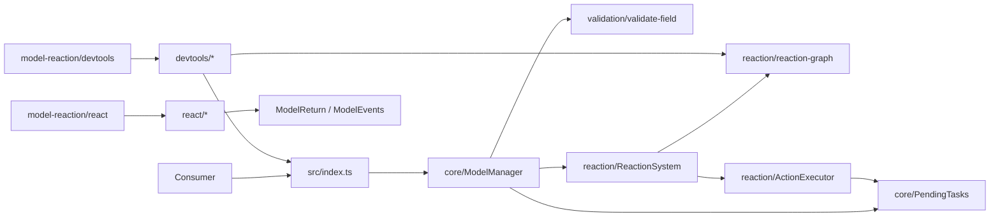

# Source Architecture

This guide maps the current `src/` modules and their main call paths. Public
behavior is specified by [API.md](API.md), [REACT.md](REACT.md), and the READMEs.

## Module map



| Path | Responsibility | Boundary |
| --- | --- | --- |
| `src/index.ts`, `src/types.ts` | Core entry point, public types, and factory | Does not export `ModelManager` or internal pipeline types |
| `src/core/` | Model state, field-write flow, events, and pending tasks | `ModelManager` is the sole owner of data, dirty data, errors, and validation freshness |
| `src/validation/` | Field validation, rule builders, and error formatting | Core calls `validate-field.ts`; rules and formatting have a separate entry |
| `src/reaction/` | Dependency indexing, scheduling, computed writeback, and action lifecycle | Uses `ReactionSystem` callbacks to access the model; owns no model data |
| `src/react/` | Provider, field bindings, draft state, and selector hooks | Uses the public model surface and ships through `model-reaction/react` |
| `src/devtools/` | Optional hook and model-inspection adapter | Reads through the public model API and shares dependency parsing |
| `src/utils/` | General helpers such as default cloning and structural comparison | Does not depend on core, React, or DevTools |
| `src/__tests__/` | Core behavior, React adapter, and integration tests | Integration tests also protect README examples |

`core/internal-types.ts` and `core/write-preparation.ts` are private implementation
modules and must not be added to package exports. React and DevTools also remain
separate package entry points.

## Write path

```text
setField ─┐
         ├─> runBatch
setFields┘    ├─ prepareFieldWrites: resolve the whole batch, then transform once
              ├─ createValidationSnapshot: build one shallow-frozen candidate
              ├─ validatePrepared: start field validations and await all of them
              │    └─ validateAndCommit: validate the latest request, commit or record dirty data
              ├─ trigger one reaction pass for fields that really changed
              └─ release the batch task, so settled() covers the whole operation
```

- `validateAll()` shares the validation/commit path but reads dirty or committed values without transforming them again.
- Reaction writeback uses `updateField()` and preserves its origin, reaction stack, and initialization context.
- Fields commit independently, so `setFields()` is not an all-or-nothing transaction.
- `ModelManager` keeps request IDs, state updates, events, and commit logic. Extract stateless preparation or calculation helpers; avoid splitting state ownership.

## Dependency rules

1. `core` coordinates state and lifecycle; `validation`, `reaction`, and `utils` provide focused capabilities.
2. `reaction` requests model reads and writes through callbacks; it does not mutate `ModelManager` state directly.
3. `react` consumes `ModelReturn` and model events; it does not import `core/` or `reaction/` implementations.
4. `devtools` reads through the public model surface. Shared `eachReactionEdge` keeps dependency graph interpretation consistent.
5. `types.ts` describes public contracts. Internal options and intermediate types stay in their owning modules and are not re-exported from the package entry.
6. `eslint.config.mjs` enforces the main reverse-dependency boundaries; DevTools' dependency on the shared reaction graph is intentional.

## Where to start

| Change | Read first |
| --- | --- |
| Writes, dirty data, events, lifecycle | `core/model-manager.ts`, `core/write-preparation.ts` |
| Validation order, timeout, and errors | `validation/validate-field.ts` |
| Dependency edges or reaction scheduling | `reaction/reaction-graph.ts`, `reaction/reaction-system.ts` |
| Action eligibility and execution | `reaction/action-executor.ts`, `reaction/reaction-job.ts` |
| React field state and subscriptions | `react/field-state.ts`, `react/draft-field.ts`, `react/selectors.ts` |
| DevTools hook, graph, and snapshots | `devtools/devtools-hook.ts`, `devtools/index.ts` |

For public contract changes, check `src/index.ts`, both READMEs, and integration
tests. For dependency graph changes, check both Reaction and DevTools consumers of
`eachReactionEdge`.
