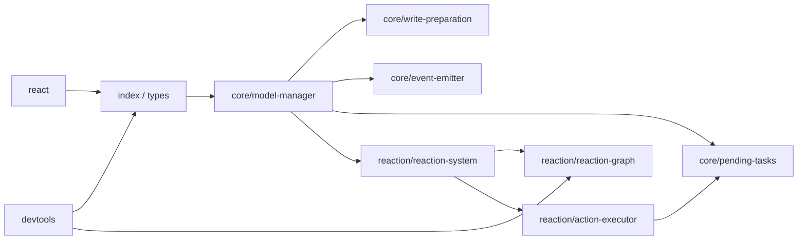

# Source Architecture

[中文版本](ARCHITECTURE_CN.md) | [Documentation](README.md)

The public contracts live in [API](API.md), [React](REACT.md), and
[DevTools](DEVTOOLS.md). This guide owns implementation responsibilities.

## Module map



| Module | Responsibility |
| --- | --- |
| `types.ts` / `index.ts` | Public types, inferred/explicit factory overloads |
| `core/model-manager.ts` | Committed data, snapshots, writes, subscriptions, lifecycle |
| `core/write-preparation.ts` | Own-key preflight and synchronous input transformation |
| `core/event-emitter.ts` | Listener snapshots, unsubscribe, exception isolation |
| `core/pending-tasks.ts` | Computation/action counts and settlement waiters |
| `reaction/reaction-system.ts` | Dependency index, synchronous execution, recursion guards, computed writeback |
| `reaction/action-executor.ts` | Versioned groups, function deduplication, per-item barriers |
| `reaction/reaction-graph.ts` | Shared declaration-to-edge parser |
| `react/field-state.ts` / `context.ts` | Field bindings and Provider/render-prop |
| `react/selectors.ts` | Shared snapshot caching with two subscription policies |
| `devtools/` | Private opt-in integration using public state/events |
| `utils/` | Default cloning and structural equality |

There is no validation module, request freshness map, dirty-data store, or
field-error store. Business checks belong to the application.

## Write path

```text
setField -> setFields
  -> begin compute task
  -> prepareFieldWrites: preflight every key, then read/transform inputs
  -> commit each prepared field
       -> structural equality check
       -> replace stored value / invalidate snapshot
       -> invalidate direct host action version
       -> collect changed fields / emit field:change
  -> finally: trigger reactions for changed fields, end compute task
```

Computed results use `updateField`: apply the host transform, then `commit`
with `origin: 'reaction'`. Direct commits advance the action version;
reaction commits retain the captured scheduling version. Defaults are cloned
without transforming and then the seeded input graph is initialized.
Preparation is not a transaction: synchronous listeners can reenter during
individual commits.

## Action scheduling

`PendingTasks` counts `compute` and `action`. Compute includes write
preparation/batches and synchronous calculation cascades. One group holds
one action task throughout candidate, barrier waiting, and item execution.
Compute reaching zero schedules a flush microtask; both counts reaching zero
resolve `settled()`.

1. Each invocation starts a compute task, increments and captures the host
   version, then runs the computation synchronously. The captured version is
   retained across reentrant writes; it never reads the latest version later
   as a substitute.
2. Successful synchronous computation/transform/commit registers a group if
   the captured host version is still current. `SKIP_REACTION` or errors
   register none.
3. Registration deduplicates references at the last array position and removes
   shared functions from older groups' unstarted items.
4. A microtask flush selects ready groups in schema order. It checks both
   compute idle and current host version immediately before synchronous call.
5. Each returned Promise is observed independently; after completion, remaining
   items recheck the calculation barrier. New host versions suppress later
   items but cannot interrupt an item already running.
6. Failure reports a host reaction error and releases only that group. Disposal
   releases all tasks and suppresses later callbacks/events.

The reaction system does not wait for action completion. `settled()` belongs
outside actions; waiting within an action deadlocks on its own task.
Application-side revision/abort policy governs network writeback.

## Retained decisions

- Structural field comparison is independent of selector equality. Changing
  it to reference equality would change downstream computations and actions.
- Two selector Hooks share caching while retaining distinct notification
  policies. Concurrent callbacks only notify React; they do not overwrite
  caches through stale selectors.
- Own field keys are supported using null-prototype storage and own-key checks.
- Schema fragments compose before model creation. Avoid duplicate field names.
- Text formatting, touched state, and write-exception feedback belong in
  application controls; the React adapter binds committed values.
- Batch preparation checks all keys before getters/transforms. Defaults remain
  untransformed; there is no implicit runtime check of type/enum metadata.

## Dependency rules and checks

Core consumes reaction/utils through focused callbacks. Reaction code does not
reach into ModelManager storage; React consumes public types/events. DevTools
uses the public model and schema plus shared edge parsing. Internal types stay
out of package exports.

Keep complex contract explanations here and short references in source.
[AGENTS.md](../AGENTS.md) owns the required checks; integration scenarios cover
public recipes, with dedicated suites for action timing and concurrent React
reads.
