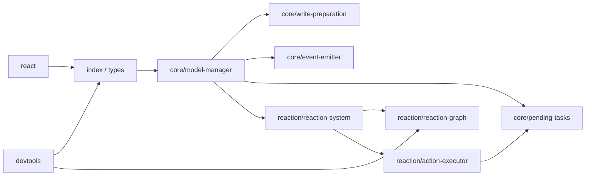

# 源码架构

[English Version](ARCHITECTURE.md) | [文档导航](README_CN.md)

公开契约由 [API](API_CN.md)、[React](REACT_CN.md)、[DevTools](DEVTOOLS_CN.md)
维护；本文负责实现职责与内部约束。

## 模块图



| 模块 | 职责 |
| --- | --- |
| `types.ts` / `index.ts` | 公共类型、推断/显式工厂重载 |
| `core/model-manager.ts` | 提交数据、快照、写入、订阅、生命周期 |
| `core/write-preparation.ts` | 自有键预检与同步输入转换 |
| `core/event-emitter.ts` | 监听器快照、取消订阅、异常隔离 |
| `core/pending-tasks.ts` | 计算/action 计数与等待者 |
| `reaction/reaction-system.ts` | 依赖索引、同步执行、递归保护、计算回写 |
| `reaction/action-executor.ts` | 版本化 action 组、函数去重、逐项屏障 |
| `reaction/reaction-graph.ts` | 共享依赖边解析 |
| `react/field-state.ts` / `context.ts` | 字段绑定与 Provider/render-prop |
| `react/selectors.ts` | 两种订阅策略共享快照缓存 |
| `devtools/` | 通过公开状态/事件进行可选私有集成 |
| `utils/` | 默认值克隆与结构比较 |

不再包含校验模块、请求新鲜度映射、dirty-data 或字段错误存储。
业务检查属于应用。

## 写入路径

```text
setField -> setFields
  -> 开始 compute 任务
  -> prepareFieldWrites：先检查全部键，再读取/转换输入
  -> 逐字段 commit
       -> 结构比较
       -> 替换值 / 失效快照
       -> 淘汰直接写入宿主的旧 action 版本
       -> 收集改变字段 / 发出 field:change
  -> finally：触发改变字段的 reaction，结束 compute 任务
```

计算结果走 `updateField`：应用宿主 transform，再以 `origin: 'reaction'`
提交。直接提交推进 action 版本，reaction 提交保留调度捕获的版本。
默认值克隆后直接播种，再初始化可达输入图。逐项事件可以同步重入，准备阶段不是事务。

## Action 调度

`PendingTasks` 分别统计 `compute` 与 `action`。计算包括批次准备
和计算链；一个组在候选、等待屏障和执行项期间只持有一个 action 任务。
计算归零安排微任务 flush；两种计数均归零完成 `settled()`。

1. 每次调用先开始计算任务，推进并捕获宿主版本，再同步执行计算。
   重入写入时保留捕获版本，不能在之后读取最新版本替代。
2. 同步计算/转换/提交成功且版本仍有效时注册 action 组；
   `SKIP_REACTION` 和错误不注册。
3. 数组内函数引用保留最后位置，共享函数从旧组未执行项中移除。
4. 微任务按 schema 顺序选取就绪组，检查计算归零和当前版本后立即同步调用。
5. 独立观察各项返回的 Promise，完成后再次检查计算屏障。
   新版本抑制后续项，但无法中断已运行项。
6. 失败报告宿主 reaction 错误并只释放所在组；
   销毁释放全部任务并抑制之后的回调/事件。

reaction 不等待 action 完成；`settled()` 只能在 action 外使用，
内部等待会等到自己。网络回写由应用的版本/abort 策略约束。

## 保留决策

- 字段结构比较独立于 selector 相等规则；改成引用比较会改变下游计算和 action。
- 两个 selector Hook 共享缓存，但保留不同通知策略。
  并发回调只通知 React，不通过过期 selector 重写缓存。
- 使用无原型存储和自有键检查，支持特殊字段名。
- Schema 片段在构造前组合，避免重复字段名。
- 文本格式、touched 和写入异常反馈由应用控件负责，React 适配器绑定提交值。
- 批量准备在 getter/transform 前检查全部键；默认值不转换，类型/枚举元数据不隐式校验。

## 依赖规则与检查

核心通过聚焦回调使用 reaction/utils；reaction 不直接读取 ModelManager 内部存储。
React 消费公共类型/事件；DevTools 使用公共模型和 schema，并共享边解析。
内部类型不导出。

复杂背景写在文档中，源码只保留短引用。
[AGENTS.md](../AGENTS.md) 维护必跑检查；集成测试覆盖公开配方，
action 时序和并发 React 读取另有专门测试。
