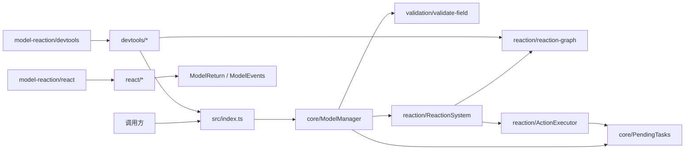

# 源码架构导览

本文说明 `src/` 当前的模块边界与核心调用路径，方便定位实现。公开行为以
[API_CN.md](API_CN.md)、[REACT_CN.md](REACT_CN.md) 和 README 为准。

[English Version](ARCHITECTURE.md) | 中文

## 模块地图



| 路径 | 职责 | 边界 |
| --- | --- | --- |
| `src/index.ts`、`src/types.ts` | 核心公开入口、公开类型和工厂函数 | 不导出 `ModelManager` 或内部流程类型 |
| `src/core/` | 模型状态、字段写入流程、事件和待处理任务 | `ModelManager` 是 `data`、`dirtyData`、错误和验证新鲜度的唯一所有者 |
| `src/validation/` | 单字段校验、规则构造、错误格式化 | `validate-field.ts` 供 core 调用；规则和格式化器由独立入口导出 |
| `src/reaction/` | 依赖索引、反应调度、计算写回和 action 生命周期 | 通过 `ReactionSystem` 回调读写模型，不持有模型数据 |
| `src/react/` | Provider、字段绑定、draft 和 selector Hooks | 只面向公开模型接口；通过独立 `model-reaction/react` 入口发布 |
| `src/devtools/` | 可选 hook 和模型观测适配 | 通过公开模型接口读取状态；使用共享依赖解析器保持图语义一致 |
| `src/utils/` | 默认值克隆、结构比较等通用纯工具 | 不依赖 core、React 或 DevTools |
| `src/__tests__/` | 按核心行为、React 适配和集成场景组织测试 | 集成测试同时约束 README 示例契约 |

`core/internal-types.ts` 与 `core/write-preparation.ts` 是内部实现文件，不能加入
包的公开导出。React 和 DevTools 也各自保持独立的发布入口。

## 写入调用链

```text
setField ─┐
          ├─> runBatch
setFields ┘     ├─ prepareFieldWrites：先解析整批 schema，再各执行一次 transform
                ├─ createValidationSnapshot：构造共享的浅冻结候选数据
                ├─ validatePrepared：并行启动字段校验，等待全部字段结束
                │    └─ validateAndCommit：校验最新请求，提交有效值或记录 dirtyData
                ├─ 用真实变更字段触发一次 reaction pass
                └─ 释放批次任务；settled() 因而覆盖整批工作
```

- `validateAll()` 使用同一校验提交流程，但直接读取 `dirtyData` 或已提交值，不重复执行 transform。
  在 `runBatch()` 释放 compute 任务后，通过 `finally` 等待 `settled()`，异常路径
  同样收尾。正常完成时检查本轮结果与当前 dirty、errors，发送
  `validation:complete` 并返回；不会为这个等待再登记任务。
- `setField()` / `setFields()` 在批次结束后返回，下游工作可能仍在进行。完整校验
  等待全部追踪工作，不重复校验，也不在创建候选快照前隐式等待。
- reaction 写回走 `updateField()`，保留 `origin`、reaction stack 和初始化上下文。
- 每个字段分别提交，所以 `setFields()` 不是全有或全无事务；一个字段失败不回滚其他有效字段。
- `ModelManager` 保留请求 ID、状态更新、事件和提交逻辑。抽取 helper 时优先选择无状态的准备或计算逻辑，不把状态拆成多个所有者。

## Action 调度

这里只记录调度的内部约束。公开行为和迁移示例统一见
[API_CN.md](API_CN.md#action-组)。

| 所有者 | 状态与职责 |
| --- | --- |
| `ReactionSystem` | 每个宿主一个 `ReactionJob`、至多一个待执行防抖计算；依赖索引与运行时路径诊断 |
| `ActionExecutor` | 宿主版本、单个组集合、Schema 字段顺序与合并后的微任务 flush |
| `PendingTasks` | 分别统计 `compute` / `action`，通知计算空闲，完成 `settled()` |
| `ModelManager` | 校验请求 ID、已提交状态与宿主字段错误 |

1. 调度宿主 reaction 时推进 action 版本；直接写入成功且宿主值变化时也推进，
   reaction 写回不推进。内部 `origin: 'direct' | 'reaction'` 区分两种路径。
   校验请求 ID 仍独立保留：它保护提交新鲜度，action 版本保护执行资格。
2. 版本在调度时捕获，防抖闭包也捕获该版本，旧计算完成时不能读取最新版本。
   防抖替换先取得新任务再释放旧任务；定时器触发先摘除等待记录再执行用户代码。
3. 计算值通过校验并提交后，仅当捕获版本仍有效才登记组。登记时立即取得一个
   action 任务，覆盖等待就绪、逐项执行与项间等待；不另设候选 Map 或集合交接。
   每组用 `actions` 队列保存未启动函数。登记时按引用保留最后一项，并从旧队列
   删除相同引用。
4. 计算空闲后安排微任务 flush。每次固定 ready 快照，按 Schema 字段顺序尝试
   启动。每项调用前同步检查销毁、版本与计算空闲，检查和调用之间不能 `await`。
   前一项可能发起新计算，因此每项都必须重新检查。
5. 各组独立等待自己的 Promise。新版本取消未启动项；已执行项仍被观察，可以
   与新组重叠。失败只停止本组，但旧项晚到的失败仍可能按既有规则更新宿主错误。
6. 任务释放幂等。销毁移除等待组并立即释放 settlement；已启动 Promise 的
   拒绝仍被观察，销毁后不再向模型报告错误。

compute 计数覆盖输入准备、校验、防抖等待、计算写回、reaction 登记与批次释放；
action 计数覆盖整组生命周期。reaction 不等待 action，`settled()` 等待两类计数，
`validateAll()` 在释放批次后复用这个全局等待。同模型的 action 或 validator 内
不能 await 这两个方法。完整校验的完成事件在落定后发送，监听者更新属于后续工作。

循环与缺失依赖诊断基于声明的计算图和运行时 reaction 路径。action 闭包中的读写
无法推断，因此不能在构造期完整检查副作用回写循环。

## 保留的设计决策

- **结构判等**：保留 `deepEqual`，内容相同的新对象不会仅因引用不同被判为变更。
  改为 `Object.is` 会同时改变下游校验、reaction、action 取消，以及 Date、NaN
  和正负零的行为。
- **两个 selector Hook**：`useModelSelector` 在模型层过滤通知，selector / 比较器
  变化时重订阅；`useModelComputed` 按 model 订阅并在快照层比较。两者共享
  render-local 缓存以保护并发渲染，合并会改变订阅策略。公开选择见
  [REACT_CN.md](REACT_CN.md#usemodelselector-vs-usemodelcomputed)。
- **单字段单 reaction**：按宿主确定 job，保留单次触发去重；不同宿主复用同一个
  reaction 对象时仍是独立 job。
- **固定校验策略**：按顺序交错执行 condition / validation，首错停止。
  批次先预检全部 key，再读取或转换输入；之后各字段独立验证和提交。
- **安全字段字典**：字段只取 Schema 自有 key；存储与快照支持 `constructor`、
  `__proto__` 等字段名，不读取继承值、不触发原型 setter。
- **UI 边界**：编辑文本与写入异常由 draft 绑定负责，核心 dirty data 保存失败的
  模型值。React 与 DevTools 保持可选入口，不把 UI 策略加入核心状态。

## 依赖规则

1. `core` 协调状态与生命周期；`validation`、`reaction` 和 `utils` 提供明确的内部能力。
2. `reaction` 只能通过回调请求模型读写，不能直接修改 `ModelManager` 的状态。
3. `react` 通过 `ModelReturn` 和事件订阅模型；不导入 `core/` 或 `reaction/` 实现。
4. `devtools` 通过公开模型表面读取数据；共享 `eachReactionEdge` 仅用于保持依赖图解释一致。
5. `types.ts` 描述公开契约；内部选项与中间态类型放在相应目录，不从包入口重导出。
6. `eslint.config.mjs` 对主要的反向依赖做静态限制；DevTools 到共享 reaction graph 的依赖是明确允许的边界。

## 按改动定位

| 改动目标 | 首先阅读 |
| --- | --- |
| 字段写入、脏数据、事件、生命周期 | `core/model-manager.ts`、`core/write-preparation.ts` |
| 字段校验顺序、超时和错误 | `validation/validate-field.ts` |
| 依赖边或反应调度 | `reaction/reaction-graph.ts`、`reaction/reaction-system.ts` |
| action 资格和执行 | `reaction/action-executor.ts`、`reaction/reaction-job.ts` |
| React 字段状态与订阅 | `react/field-state.ts`、`react/draft-field.ts`、`react/selectors.ts` |
| DevTools hook、字段图和快照 | `devtools/devtools-hook.ts`、`devtools/index.ts` |

改动公开契约时同步检查 `src/index.ts`、两个 README 和集成测试；改动依赖图解释时，
同时检查 Reaction 与 DevTools 对 `eachReactionEdge` 的使用。
