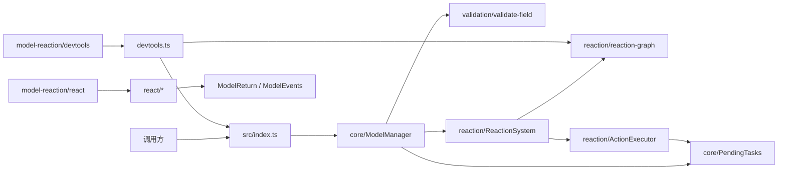

# 源码架构导览

本文说明 `src/` 当前的模块边界与核心调用路径，方便定位实现。公开行为以
[API_CN.md](API_CN.md)、[REACT_CN.md](REACT_CN.md) 和 README 为准。

[English Version](ARCHITECTURE.md) | 中文

## 模块地图



| 路径 | 职责 | 边界 |
| --- | --- | --- |
| `src/index.ts`、`src/types.ts` | 核心公开入口、公开类型和工厂函数 | 不导出 `ModelManager` 或内部流程类型 |
| `src/core/` | 模型状态、字段写入流程、默认值克隆、结构比较、事件和待处理任务 | `ModelManager` 是 `data`、`dirtyData`、错误和验证新鲜度的唯一所有者 |
| `src/validation/` | 单字段校验、规则构造、错误格式化 | `validate-field.ts` 供 core 调用；规则和格式化器由独立入口导出 |
| `src/reaction/` | 依赖索引、反应调度、计算写回和 action 生命周期 | 通过 `ReactionSystem` 回调读写模型，不持有模型数据 |
| `src/react/` | Provider、字段绑定、draft 和 selector Hooks | 只面向公开模型接口；通过独立 `model-reaction/react` 入口发布 |
| `src/devtools.ts` | 可选 hook 和模型观测适配 | 只导出 `createModel`；通过公开模型接口读取状态，使用共享依赖解析器保持图语义一致 |
| `src/__tests__/` | 按核心行为、React 适配和集成场景组织测试 | 集成测试同时约束 README 示例契约 |

`core/write-preparation.ts` 统一保存内部提交选项、待写入字段类型和无状态准备函数，
都不加入包的公开导出。默认值克隆和结构比较分别保留独立文件，归入 `core/`。
`validation/index.ts` 导出规则构造器，并直接实现小型错误格式化函数。
React 和 DevTools 也各自保持独立的发布入口。
`devtools.ts` 的 hook 类型和辅助函数保持私有。测试通过全局 hook 捕获注册实例，
不直接导入内部辅助函数。

`types.ts` 按 Schema/推导、错误/事件和实例 API 分区。字段标签共用一个值类型映射，
推导读值还包含默认值与 computed 结果；适配层共用 `ValidationErrors` 和
字符串/数字字段键类型。`Model<T>` 仍是调用方提供的数据类型承诺，详见
[API_CN.md](API_CN.md#数据类型推导)。

类型契约测试位于 `__tests__/type-inference.test.ts`，精确断言由
`__tests__/public-type-contracts.ts` 提供。`verify:exports` 在临时目录中，
通过 Bundler 与 NodeNext 的 ESM/CommonJS 消费方式，用同一组契约检查构建后的
声明文件，结束后清理目录。
`tsconfig.build.json` 排除整个测试目录，包括辅助文件；
默认类型检查项目仍检查全部源码和测试。

## 写入调用链

```text
setField ─┐
          ├─> runBatch
setFields ┘     ├─ prepareFieldWrites：先解析整批 schema，再各执行一次 transform
                ├─ createValidationSnapshot：构造共享的浅冻结候选数据
                ├─ validatePrepared：并行启动字段校验，等待全部字段结束
                │    └─ validateAndCommit：校验最新请求，提交有效值或记录 dirtyData
                ├─ 用真实变更字段触发一次 reaction pass
                └─ 释放批次任务；settled() 因而覆盖整批工作
```

- `validateAll()` 使用同一校验提交流程，但直接读取 `dirtyData` 或已提交值，不重复执行 transform。
  在 `runBatch()` 释放 compute 任务后，通过 `finally` 等待 `settled()`，异常路径
  同样收尾。正常完成时检查本轮结果与当前 dirty、errors，发送
  `validation:complete` 并返回；不会为这个等待再登记任务。
- `setField()` / `setFields()` 在批次结束后返回，下游工作可能仍在进行。完整校验
  等待全部追踪工作，不重复校验，也不在创建候选快照前隐式等待。
- reaction 写回走 `updateField()`，保留 reaction stack 和初始化上下文。
- 每个字段分别提交，所以 `setFields()` 不是全有或全无事务；一个字段失败不回滚其他有效字段。
- 每个字段的校验请求 ID 独立递增，新鲜度只比较同字段请求，不再维护全局请求计数器。
- `validatePrepared()` 每批只构造一个提交选项对象，共享候选快照与真实变更字段 Set；
  流程读取选项，不替换其中的属性。
- 有效提交先清除 dirty 条目，再通知监听者。只有值变化时才更新 data、使其快照失效并
  发送 `field:change`；等值提交仍可传播 reaction 初始化。`ModelManager` 直接通过
  typed event bus 发送事件。校验和 reaction 错误属于可恢复事件，通过 `model.on(...)`
  观察或记录。
- `ModelManager` 保留请求 ID、状态更新、事件和提交逻辑。抽取 helper 时优先选择无状态的准备或计算逻辑，不把状态拆成多个所有者。

## Reaction 调度

宿主字段名是 reaction 在实例内的身份。构造时通过 `eachReactionEdge` 建立
`dependentsByField: Map<依赖字段, Set<宿主字段>>`；执行时从固定 Schema 读取宿主定义，不另存 job
或 reaction 定义缓存。单次 pass 使用 `firstSourceByOwner: Map<宿主字段, 首次触发来源>`，保持
变更字段遍历顺序与宿主首次出现顺序，并只将真实来源追加到 reaction stack。

索引去重不改变 `reaction.fields` 声明；计算仍按原数组读取依赖，包括重复读取。
`initializingFields` 保留尚未完成初始化的宿主，普通重调度不会丢失标记。
防抖仍先取得替换后的 compute 任务，再释放旧任务；定时器触发先摘除记录，
再执行用户代码。局部 run 闭包保存本次字段、路径与任务释放函数。
校验请求 ID 继续保护计算提交，成功后才把宿主与 action 数组交给 executor。

## Action 调度

这里只记录调度的内部约束。公开行为和迁移示例统一见
[API_CN.md](API_CN.md#action-队列)。

| 所有者 | 状态与职责 |
| --- | --- |
| `ReactionSystem` | 字段依赖索引、首次触发来源、初始化标记；每个宿主至多一个待执行防抖计算与运行时路径诊断 |
| `ActionExecutor` | 按 action 函数引用索引的单个 Map 与合并后的微任务 flush |
| `PendingTasks` | 分别统计 `compute` / `action`，通知计算空闲，完成 `settled()` |
| `ModelManager` | 校验请求 ID、已提交状态与宿主字段错误 |

1. 计算值通过校验并提交后，将每个函数登记到
   `Map<ReactionAction, { field, endTask }>`。相同 key 先删除再插入，最后进入的记录
   决定 action 上下文与错误的宿主并移到队尾。覆盖时复用原待执行任务；
   每个唯一函数持有一个 action 任务，覆盖排队等待及返回的 Promise。
2. 计算空闲后安排微任务 flush。微任务执行时再次检查计算空闲，取出快照并在执行
   用户代码前清空 Map。每项调用前通过模型回调读取宿主的已提交值，传入
   `{ field, value }`，队列不保存值。按登记顺序调用所有就绪函数，
   项间不等待、不重新检查计算。
   重入时登记的函数属于后续 flush。
3. 每次调用独立观察自己的 PromiseLike，并在 `finally` 释放任务。已经开始的调用
   不参与去重。错误归属于登记记录中的宿主，不阻止其他函数；不再维护宿主版本、
   执行组、schema 排序或逐项计算屏障。
4. 任务释放幂等。销毁清空队列并阻止剩余就绪调用；`ModelManager` 销毁共享任务，
   立即释放 settlement。已启动 Promise 的拒绝仍被观察，销毁后不再向模型报告错误。

compute 计数覆盖输入准备、校验、防抖等待、计算写回、reaction 登记与批次释放；
action 计数覆盖唯一待执行函数及已启动调用。reaction 不等待 action，`settled()` 等待两类计数，
`validateAll()` 在释放批次后复用这个全局等待。同模型的 action 或 validator 内
不能 await 这两个方法。完整校验的完成事件在落定后发送，监听者更新属于后续工作。

循环与缺失依赖诊断基于声明的计算图和运行时 reaction 路径。action 闭包中的读写
无法推断，因此不能在构造期完整检查副作用回写循环。

## 保留的设计决策

- **Schema 配置固定**：在 `createModel` 前组装定义，实例生命周期内保持共享引用
  不变；工厂不对 Schema 做深克隆或冻结。这允许在构造时建立依赖索引，并在后续
  从同一份定义读取配置，但不代表所有依赖都合法，也不改变缺失依赖与循环诊断。
  公开契约见 [Schema 固定性](API_CN.md#schema-固定性)。
- **结构判等**：保留 `deepEqual`，内容相同的新对象不会仅因引用不同被判为变更。
  改为 `Object.is` 会同时改变下游校验、reaction/action 触发，以及 Date、NaN
  和正负零的行为。
- **两个 selector Hook**：`useModelSelector` 在模型层过滤通知，selector / 比较器
  变化时重订阅；`useModelComputed` 按 model 订阅并在快照层比较。两者共享
  render-local 缓存以保护并发渲染，合并会改变订阅策略。公开选择见
  [REACT_CN.md](REACT_CN.md#usemodelselector-vs-usemodelcomputed)。
- **单字段单 reaction**：以宿主字段名确定身份，保留单次触发去重；不同宿主复用
  同一个 reaction 对象时仍独立计算。
- **固定校验策略**：按顺序交错执行 condition / validation，首错停止。
  批次先预检全部 key，再读取或转换输入；之后各字段独立验证和提交。
- **安全字段字典**：字段只取 Schema 自有 key；存储与快照支持 `constructor`、
  `__proto__` 等字段名，不读取继承值、不触发原型 setter。
  初始化时为全部已声明字段在无原型存储中建立自有属性，包括值为 `undefined`
  的字段。展开为普通浅冻结数据/候选快照时保留这些 key；
  只有默认值不为 `undefined` 的非派生字段才启动初始化 reactions。
- **UI 边界**：编辑文本与写入异常由 draft 绑定负责，核心 dirty data 保存失败的
  模型值。React 与 DevTools 保持可选入口，不把 UI 策略加入核心状态。
  `DraftSession` 留在 `react/draft-field.ts`；完成事件监听在微任务中注册，
  早于本次写入的异步校验恢复，避免重入编辑认领前一次同步派发的完成事件。

## 依赖规则

1. `core` 协调状态、值处理与生命周期；`validation` 和 `reaction` 提供明确的内部能力。
2. `reaction` 只能通过回调请求模型读写，不能直接修改 `ModelManager` 的状态。
3. `react` 通过 `ModelReturn` 和事件订阅模型；不导入 `core/` 或 `reaction/` 实现。
4. `devtools` 通过公开模型表面读取数据；共享 `eachReactionEdge` 仅用于保持依赖图解释一致。
5. `types.ts` 描述公开契约；内部选项与中间态类型放在相应目录，不从包入口重导出。
6. `eslint.config.mjs` 对主要的反向依赖做静态限制；DevTools 到共享 reaction graph 的依赖是明确允许的边界。

## 按改动定位

| 改动目标 | 首先阅读 |
| --- | --- |
| 字段写入、脏数据、事件、生命周期 | `core/model-manager.ts`、`core/write-preparation.ts` |
| 默认值克隆和结构判等 | `core/clone-default.ts`、`core/deep-equal.ts` |
| 字段校验顺序、超时和错误 | `validation/validate-field.ts` |
| 依赖边或反应调度 | `reaction/reaction-graph.ts`、`reaction/reaction-system.ts` |
| action 资格和执行 | `reaction/reaction-system.ts`、`reaction/action-executor.ts` |
| React 字段状态与订阅 | `react/field-state.ts`、`react/draft-field.ts`、`react/selectors.ts` |
| DevTools hook、字段图和快照 | `devtools.ts` |

改动公开契约时同步检查 `src/index.ts`、两个 README 和集成测试；改动依赖图解释时，
同时检查 Reaction 与 DevTools 对 `eachReactionEdge` 的使用。
