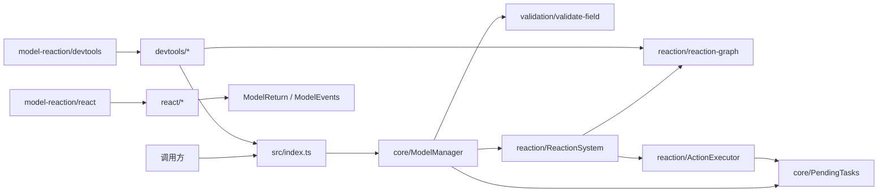

# 源码架构导览

本文说明 `src/` 当前的模块边界与核心调用路径，方便定位实现。公开行为以
[API_CN.md](API_CN.md)、[REACT_CN.md](REACT_CN.md) 和 README 为准。

## 模块地图



| 路径 | 职责 | 边界 |
| --- | --- | --- |
| `src/index.ts`、`src/types.ts` | 核心公开入口、公开类型和工厂函数 | 不导出 `ModelManager` 或内部流程类型 |
| `src/core/` | 模型状态、字段写入流程、事件和待处理任务 | `ModelManager` 是 `data`、`dirtyData`、错误和验证新鲜度的唯一所有者 |
| `src/validation/` | 单字段校验、规则构造、错误格式化 | `validate-field.ts` 供 core 调用；规则和格式化器由独立入口导出 |
| `src/reaction/` | 依赖索引、反应调度、计算写回和 action 生命周期 | 通过 `ReactionSystem` 回调读写模型，不持有模型数据 |
| `src/react/` | Provider、字段绑定、draft 和 selector Hooks | 只面向公开模型接口；通过独立 `model-reaction/react` 入口发布 |
| `src/devtools/` | 可选 hook 和模型观测适配 | 通过公开模型接口读取状态；使用共享依赖解析器保持图语义一致 |
| `src/utils/` | 默认值克隆、结构比较等通用纯工具 | 不依赖 core、React 或 DevTools |
| `src/__tests__/` | 按核心行为、React 适配和集成场景组织测试 | 集成测试同时约束 README 示例契约 |

`core/internal-types.ts` 与 `core/write-preparation.ts` 是内部实现文件，不能加入
包的公开导出。React 和 DevTools 也各自保持独立的发布入口。

## 写入调用链

```text
setField ─┐
          ├─> runBatch
setFields ┘     ├─ prepareFieldWrites：先解析整批 schema，再各执行一次 transform
                ├─ createValidationSnapshot：构造共享的浅冻结候选数据
                ├─ validatePrepared：并行启动字段校验，等待全部字段结束
                │    └─ validateAndCommit：校验最新请求，提交有效值或记录 dirtyData
                ├─ 用真实变更字段触发一次 reaction pass
                └─ 释放批次任务；settled() 因而覆盖整批工作
```

- `validateAll()` 使用同一校验提交流程，但直接读取 `dirtyData` 或已提交值，不重复执行 transform。
- reaction 写回走 `updateField()`，保留 `origin`、reaction stack 和初始化上下文。
- 每个字段分别提交，所以 `setFields()` 不是全有或全无事务；一个字段失败不回滚其他有效字段。
- `ModelManager` 保留请求 ID、状态更新、事件和提交逻辑。抽取 helper 时优先选择无状态的准备或计算逻辑，不把状态拆成多个所有者。

## 依赖规则

1. `core` 协调状态与生命周期；`validation`、`reaction` 和 `utils` 提供明确的内部能力。
2. `reaction` 只能通过回调请求模型读写，不能直接修改 `ModelManager` 的状态。
3. `react` 通过 `ModelReturn` 和事件订阅模型；不导入 `core/` 或 `reaction/` 实现。
4. `devtools` 通过公开模型表面读取数据；共享 `eachReactionEdge` 仅用于保持依赖图解释一致。
5. `types.ts` 描述公开契约；内部选项与中间态类型放在相应目录，不从包入口重导出。
6. `eslint.config.mjs` 对主要的反向依赖做静态限制；DevTools 到共享 reaction graph 的依赖是明确允许的边界。

## 按改动定位

| 改动目标 | 首先阅读 |
| --- | --- |
| 字段写入、脏数据、事件、生命周期 | `core/model-manager.ts`、`core/write-preparation.ts` |
| 字段校验顺序、超时和错误 | `validation/validate-field.ts` |
| 依赖边或反应调度 | `reaction/reaction-graph.ts`、`reaction/reaction-system.ts` |
| action 资格和执行 | `reaction/action-executor.ts`、`reaction/reaction-job.ts` |
| React 字段状态与订阅 | `react/field-state.ts`、`react/draft-field.ts`、`react/selectors.ts` |
| DevTools hook、字段图和快照 | `devtools/devtools-hook.ts`、`devtools/index.ts` |

改动公开契约时同步检查 `src/index.ts`、两个 README 和集成测试；改动依赖图解释时，
同时检查 Reaction 与 DevTools 对 `eachReactionEdge` 的使用。
