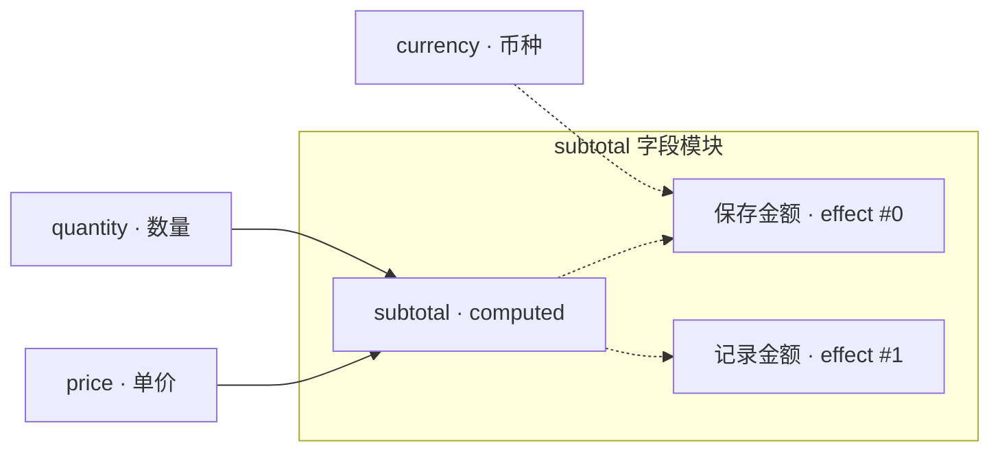

# 设计记录：字段级副作用依赖（Effect Dependencies）

> **状态：字段级方案及 D1–D3 已确认；D4–D8 待定；尚未实现。**
> 更新日期：2026-10-16。
> 当前代码只有 `Reaction.action`，尚无 `Effect` 类型或 `reaction.effects`。
> 本文中的类型、示例和图协议均为提案，不能作为已发布 API 使用。
> §3 和 §7.1 记录已确认的结论；§7.2–§7.3 的建议仍待确认。
> 实现时应同步更新 README / README_CN / AGENTS.md 及相关 API、DevTools 文档。

## 1. 目标与方案选择

本库主要服务字段模块。期望在同一张图中看清字段的计算关系，以及字段变化
触发哪些副作用，同时保持字段定义便于阅读、组合和复用。

采用字段级 `reaction.effects` 数组：副作用与所属字段的计算定义放在一起，
每个 effect 独立声明 `deps`。不采用 model options 中的全局 `effects` 数组。

需要区分两个维度：

- **职责归属**：effect 挂在哪个字段模块下，决定代码组织和图中的展示位置。
- **触发依赖**：effect 的 `deps` 决定哪些已提交字段变化会触发它。

职责归属不限制触发依赖。一个 effect 可以监听宿主字段、其他计算字段或普通
输入字段；它的触发也不以宿主 `computed` 本轮执行或成功为前提。

现有 `action` 随计算提交成功执行，参数与 `computed` 共享依赖来源
（见 [Reaction 类型](../src/types.ts) 和
[processReaction](../src/reaction/reaction-system.ts)）。
它没有独立的触发声明。独立 `deps` 加上独立 effect 节点，才能让两类关系分别可见。

## 2. 声明结构与示例

### 2.1 基础类型提案

```ts
interface Effect {
  /** 触发依赖，任一字段的已提交值变化即可命中。 */
  deps: string[];
  /** 接收本轮计算落定后的模型快照，返回值不写入 data。 */
  run: (values: Readonly<Record<string, any>>) => void | PromiseLike<void>;
}

interface ComputedReaction {
  fields: string[];
  computed: (values: Record<string, any>) => any;
  effects?: Effect[];
  /** 保留旧行为：宿主计算值校验通过后执行。 */
  action?: (data: Record<string, any>) => void | PromiseLike<void>;
}

interface EffectsOnlyReaction {
  effects: Effect[];
  fields?: never;
  computed?: never;
  action?: never;
}

type Reaction = ComputedReaction | EffectsOnlyReaction;
```

`fields` 继续表示 `computed` 的输入字段，`computed` 继续保持同步、纯函数契约。
`effects` 与 `computed` 在 reaction 内平级，每项有自己的 `deps` 和 `run`。
字段仍支持单项或数组声明，数组中可组合计算 reaction 和仅含 effects 的
reaction。计算分支要求 `fields` / `computed` 成对提供，并继续允许旧 `action`；
纯副作用分支无需伪 computed，也不允许使用依赖计算提交成功的旧 `action`。

此结构表达 D1 保留旧 action、D2 支持纯副作用的声明形态。
公开类型如何命名和扩展仍需通过 D7 确定，不能据此声称完整类型兼容。

**公开类型兼容边界（D7 待确认）**：
当前 `Reaction` 是从 [index.ts](../src/index.ts) 公开导出的 interface。
将同名类型改为上述联合类型，普通计算声明仍能赋值，但读取或扩展该类型的
消费者会受到影响：

- 未经收窄读取 `reaction.fields` 时，类型从 `string[]` 扩为 `string[] | undefined`；
  原先要求数组的代码可能报 TS2322，`computed` 的直接调用也需要收窄。
- `interface X extends Reaction` 原先合法，改为联合类型后会报 TS2312。

D1 保留的是旧 action 的函数签名和运行时语义，并不自动解决这些公开类型变化。
兼容性优先的补充建议是保留公开 `Reaction` interface 作为计算分支，
另加 `ReactionDefinition` 等联合类型用于 `FieldSchema.reaction`。
这样原先明确使用 `Reaction` 的代码可以继续读取或扩展，但读取扩宽后的
`FieldSchema.reaction` 仍需区分计算与纯副作用分支；不能承诺所有消费代码都无需修改。

### 2.2 字段模块示例

以下为设计示例，`saveAmount` 和 `trackSubtotal` 由业务提供：

```ts
const schema = {
  price: { type: 'number', default: 10 },
  quantity: { type: 'number', default: 2 },
  currency: { type: 'string', default: 'CNY' },
  subtotal: {
    type: 'number',
    default: 0,
    reaction: {
      fields: ['price', 'quantity'],
      computed: ({ price, quantity }) => price * quantity,
      effects: [
        {
          deps: ['subtotal', 'currency'],
          run: async ({ subtotal, currency }) => {
            await saveAmount(subtotal, currency);
          },
        },
        {
          deps: ['subtotal'],
          run: ({ subtotal }) => {
            trackSubtotal(subtotal);
          },
        },
      ],
    },
  },
};
```

在一次后续更新中，币种变化只命中保存 effect，不会因此重算小计。
单价或数量变化先重算小计；小计的已提交值实际变化后，两个 effect 都会命中。
同一轮小计和币种都变化时，保存 effect 只执行一次。默认值播种及初始小计计算
不触发这两个 effect；模型建立后，依赖的已提交值真实变化才触发。

### 2.3 仅声明 effects 的输入字段

普通输入字段可以直接声明副作用，无需添加 `fields` 或 `computed`：

```ts
const nameField = {
  type: 'string',
  default: '',
  reaction: {
    effects: [
      {
        deps: ['name'],
        run: async ({ name }) => {
          await saveName(name);
        },
      },
    ],
  },
};
```

此处 `saveName` 由业务提供，`nameField` 用作 schema 中的 `name` 字段。
创建模型不会调用 `saveName`；后续 name 的有效提交发生真实变化时才调用。
仅含 effects 的字段仍是输入字段：其默认值应能作为其他 computed 的初始化输入。

### 2.4 参数与读取范围

`run(values)` 接收本轮计算落定后的完整已提交模型快照，而非仅由 `deps` 投影出的
字段集合；不附加旧 action 的特殊 `computed` 参数。

`deps` **只表示触发条件，不表示完整读取集合**。`run` 可以读取未列入 `deps` 的
字段，但这些字段变化不会单独触发该 effect。需要响应其变化时，业务应将其加入
`deps`。图中的虚线不能被解释为完整的读取依赖或自动推断的回写关系。

同一轮选出的 effects 使用同一份浅只读快照。快照创建后，后续字段替换不会改变
该快照的顶层字段值；对象、数组等字段内容不深克隆或深冻结，与现有
[model.data](../src/core/model-manager.ts) 的浅快照约定一致。业务不能原地修改字段内容。
effect 的普通返回值不参与 data，写回仍通过现有 `setField` / `setFields`。

**回写回调的 TypeScript 推导约定**：
在 `const model = createModel(schema)` 的同一个初始化表达式内，由 schema 回调引用
`model` 时，表达式体 `run: (v) => model.setField(...)` 可能形成返回类型推导循环，
在 TypeScript 5.9 下报 TS7022（model 隐式 any）和 TS7023（回调返回类型隐式 any）。
现有 action 有同样的问题，提案的 effects 签名也能复现。

此外，`setField` / `setFields` 返回 `Promise<boolean>`，直接返回它不符合
`void | PromiseLike<void>` 的副作用契约。即使通过显式类型打断推导循环，
仍需处理这个返回类型差异。回写示例统一使用 async 块体，await 写入但不返回布尔值：

```ts
const model = createModel({
  source: {
    type: 'number',
    default: 0,
    reaction: {
      effects: [
        {
          deps: ['source'],
          run: async ({ source }) => {
            await model.setField('result', source * 2);
          },
        },
      ],
    },
  },
  result: { type: 'number', default: 0 },
});
```

上例仍是未来 API 的设计示例；它使用纯副作用字段，并回写未列入自身 deps 的 result。
同一写法也适用于旧 action。回写失败若需要业务处理，可在块体内检查返回布尔值，
但不要将它作为 `run` 的返回值。

## 3. 已确认的语义决策

| 项目 | 结论 |
|---|---|
| 声明归属 | 使用字段级 `reaction.effects`，副作用随字段模块组织。 |
| D1：旧 action | 先保留旧 action，继续使用原有计算提交成功后的执行语义。 |
| D2：纯副作用字段 | 支持仅声明 `reaction.effects`；计算分支的 fields / computed 成对提供。 |
| D3：初始化 | effects 默认不执行；默认值播种和初始派生提交均不作为其触发，后续真实变化才触发。 |
| 独立依赖 | 每个 effect 自带 `deps`，可监听 schema 中任意字段，不受宿主 `fields` 限制。 |
| 多字段触发 | 任一 dep 的已提交值实际变化即可命中；同一轮每个 effect 最多执行一次。 |
| 变化判断 | 复用提交时的 `deepEqual` 判断；仅错误或 dirtyData 变化不构成 effect 触发。 |
| 执行阶段 | 本轮全部 computed 及其写回校验落定后，匹配最终变化集并获取快照。 |
| 宿主关系 | 宿主 computed 未执行、返回 `SKIP_REACTION` 或失败，不单独阻止 effect；仍按其 deps 判断。 |
| 图的实线 | 依赖字段 → 计算字段，表示计算依赖。 |
| 图的虚线 | dep 字段 → 独立 effect 节点，表示副作用触发。 |
| 图的归属 | effect 节点显示在所属字段模块内；多个 effect 分别展示。 |
| 异步等待 | effect 返回的 PromiseLike 纳入 `PendingTasks`，`settled()` 必须等到完成。 |
| 循环防护 | 保留原提案的“省心档”：初版不检测 effect 回写形成的循环。 |

变化判断发生在每次提交时。一轮内某字段先变化再恢复原值，是否仍算触发，
以及并发入口更新如何划分“同一轮”，还需要通过 D4 明确。

不检测回写循环意味着业务应避免直接或经其他 computed / effect 链反复改变自己的
deps。写入深相等的值不会再次触发；持续改变值的闭环可能无限运行，导致
`settled()` 始终无法自然完成。此约定不影响已有 computed 的循环检测。

构造时检查依赖配置，与检测实际回写循环是不同能力。
计算依赖可以根据 `fields → 宿主字段` 建立已声明的有向图；
但当前 effect 只声明触发 deps，`run` 可通过闭包动态写入字段，且没有 `writes`
元数据。因此无法在构造时完整检查 effect 的真实回写循环。
宿主归属也不能被当作 effect 必然回写宿主的边，否则监听自己并仅记录日志的
合法 effect 会被误判。初版继续保留上述循环防护决定；
若增加构造时计算图检查，或扩充 effect 回写声明，应作为另外的方案决策。

## 4. 运行时落地要求

### 4.1 复用变化判断，补齐变化收集

[commitValid](../src/core/model-manager.ts) 已通过 `deepEqual` 判断 `dataChanged`，
只有实际提交变化才通知字段变更并登记变化。无需为 effect 再增加一套值比较。

但是，当前 `runBatch` 的 `changedFields` 只收集本次直接批量提交的字段；
`processReaction` 回写时只传递 `reactionStack`，没有将整个计算链的变化汇入同一个
Set。因此，**计算链落定后的最终变化集是待实现能力，不能视为已有机制**。

实际记录应汇聚在 `commitValid` 的 `dataChanged` 分支，覆盖入口提交和 computed
提交，再由计算阶段完成信号协调 effect。当前链 `a → b` 在
`setFields({ a: 1 })` 后，入口调度收到 `["a"]` 和空 stack，
b 的提交随后单独调度 `["b"]`，stack 为 `["a"]`；
不能只用入口变化集代表整个计算链。

还要注意，现有 `CommitOptions.changedFields` 同时控制变化收集和逐字段 reaction
调度：提供该 Set 时会抑制立即调度。不能简单把它透传到所有 computed 回写，
否则可能收集到了变化，却停止了下游计算。需要分别表达“记录本轮变化”和
“批量入口暂缓调度”，并保留现有 `reactionStack` 的真实计算路径。

### 4.2 计算阶段与 effect 阶段

一次后续更新的逻辑顺序应为：

1. 入口字段完成校验并提交，记录有效变化；未通过的值继续进入 dirtyData。
2. 调度 computed，等待级联计算、写回校验，以及当前轮待执行的计算任务落定。
3. 汇总入口和派生字段的实际变化，确定匹配的 effect 声明并去重。
4. 固定本轮变化集，获取一次模型快照，登记所选 effect 任务后执行 `run`。
5. effect 写回继续走正常校验和计算管线，形成下一轮变化，不追加到已固定的上一轮。

“落定”包含成功、跳过、失败，以及过期校验结果被忽略后的任务结束；
不要求每个计算字段都校验成功。effects 读取最终保留的 committed 值。
计算与校验可能跨多个微任务，reaction 还可能有防抖，不能用“等一个微任务”
代替计算阶段完成的判断。并发更新与防抖的轮次归并见 D4。

旧 action 已确定保留，仍需明确其异步执行和回写与计算阶段的边界；
不能直接把包含 action 的整个 `processReaction` 当作纯计算阶段。

初始化阶段仍建立默认值并运行初始计算链，但不能将其变化用于启动 effects。
这是对 effects 的规则；旧 action 的初始化执行行为仍保持兼容。
初始化尚未落定时收到的后续入口更新需要单独识别，不能被初始化抑制规则吞掉；
与并发更新的轮次归并一起通过 D4 明确。

### 4.3 索引与任务身份

在现有“dep 字段 → computed job”索引之外，新增“dep 字段 → effect job”索引。
同一个 effect 被多个 dep 命中时，本轮只登记一次。

每个 effect job 需要保留宿主字段、reaction 位置和 effect 位置，使运行时、
错误信息和 DevTools 能识别同一个声明。不能只用 `run` 函数引用去重：
同一函数可能被复用到不同字段模块。重复声明和重复 dep 的具体规则见 §7。

实际新增工作包含 effect 索引、计算阶段协调、最终变化收集和任务身份，
而不只是增加一张索引。内部职责仍由 `ModelManager` 协调提交与状态，
`ReactionSystem` 协调派生任务；新增能力不引入第二套对外异步状态中心。

### 4.4 `settled()` 与生命周期

所有排队和执行中的 effect 都通过
[PendingTasks](../src/core/pending-tasks.ts) 的 `begin()` / `end()` 追踪，
并保证同步抛错、Promise 拒绝和正常完成都能释放任务。

从计算阶段转入 effect 阶段时，应先登记新任务，再释放阶段持有任务；
防抖替换也沿用“先 begin 新任务，再 end 旧任务”的顺序，避免假空闲。

**不能用全局 `settled()` 作为 effect 的启动条件**：它还包含其他异步副作用，
如果提前登记当前 effect，就会等待自身。应通过计算阶段完成信号协调启动；
`PendingTasks` 继续承担对外的整体等待。业务也不能在当前 `run` 内等待同一模型的
`settled()`，因为当前 effect 本身仍是其等待对象。

`dispose()` 应停止未开始的 effect，禁止继续调度，并沿用现有等待者释放语义。
已开始的 Promise 仍应观察其拒绝，销毁后不再向模型上报结果。
当前签名未提供 AbortSignal，因此不能承诺自动取消已经发出的业务请求。

## 5. 依赖图与 DevTools

### 5.1 两类边与字段归属



实线从字段指向计算字段；虚线从 dep 字段指向 effect 节点。
字段容器表示职责归属，不额外产生触发边。只有显式将宿主字段列入 `deps`，
才有宿主字段到 effect 的虚线。

多个 effect 即使有相同 deps，也保留各自的节点。界面可以提供字段折叠和展开，
但底层图不能将不同 effect 合并为一项。初版不自动推断 effect → 字段的回写边，
也不增加 `writes` 声明。

### 5.2 图协议草案

当前 [DevtoolsDependencyGraph](../src/devtools/devtools-hook.ts) 的节点只有字段名。
独立 effect 节点需要节点种类和归属信息；仅给现有边添加 `kind` 不足以表达本方案。
可采用以下结构，具体 ID 编码属于实现细节：

```ts
type DependencyNode =
  | { id: string; kind: 'field'; field: string }
  | {
      id: string;
      kind: 'effect';
      ownerField: string;
      reactionIndex: number;
      effectIndex: number;
    };

interface DependencyEdge {
  from: string;
  to: string;
  kind: 'compute' | 'effect';
}
```

节点 ID 应区分字段与 effect 的命名空间，避免与任意合法字段名碰撞。
同一实例、同一固定 schema 的 effect 身份应稳定；初版可从声明位置生成，
不要求业务填写公开 `id`。默认标签可使用宿主字段及声明位置，不依赖函数名，
以免受匿名函数或代码压缩影响。

### 5.3 单一依赖来源

运行时索引和 DevTools 必须经由同一个 schema 遍历原语或共享的声明遍历，
读取 `fields`、`deps` 及 effect 身份。可扩展
[eachReactionEdge](../src/reaction/reaction-graph.ts)，但不能让图层独立解析 deps。

扩展 [reaction-graph 锁定测试](../src/__tests__/reaction-graph.test.ts)，
保持 primitive、runtime、graph 的依赖解释一致。图边去重需要包含 kind 和
完整目标身份，不能仅按宿主字段合并。协议变更还需同步字段详情、序列化、
图布局和 DevTools 测试，确保孤立字段及多个 effect 都能正确显示。

## 6. 与现有 action 的差异

| 项目 | 当前 `reaction.action` | 提案 `reaction.effects` |
|---|---|---|
| 触发依据 | 宿主 computed 校验通过，即使提交值相等也可能执行 | 自己声明的 dep 实际变化 |
| 是否依赖宿主计算成功 | 是；跳过或失败会跳过 action | 否；按自身 deps 与最终 committed 状态判断 |
| 参数 | 计算前读取的依赖字段值，以及特殊 `computed` 属性 | 本轮计算落定后的完整模型快照 |
| 读取其他字段 | 参数不提供；业务仍可通过闭包自行读取模型 | 可直接从快照读取，但触发仍由 deps 决定 |
| 异步任务 | 计入 settled，并占用宿主字段的现有 reaction 队列 | 计入 settled，重入与排队规则见 D5 |
| 图中的身份 | 没有独立的触发声明与节点 | 每个 effect 有自己的触发边及字段内节点 |

因此不能将旧 action 机械搬入 effects 后声称行为等价。特别是
`deps: [宿主字段]` 仅响应宿主值变化，不能复现每次计算校验成功都执行的旧行为。
已确认先保留旧 action。现有声明继续工作，迁移到 effects 时需要主动选择 deps，
并接受变化触发、快照及初始化规则的区别；不自动将旧 action 转换为 effect。

## 7. 决策进度与剩余事项

### 7.1 已确认：D1–D3

| 编号 | 已确认结论 | 实现要求 |
|---|---|---|
| D1 | 先保留旧 action。 | 保留 action 的函数签名与运行时触发行为；公开 Reaction 类型兼容另由 D7 明确。 |
| D2 | 支持仅声明 `reaction.effects`。 | 使用计算 / 纯副作用联合类型；普通输入字段不必添加伪 computed。 |
| D3 | effects 默认不执行，后续真实变化才触发。 | 默认值播种及初始派生提交不触发 effects；保留旧 action 的初始化行为。 |

D2 要求调整当前 `initializeDefaults` 通过“是否存在 reaction”识别输入字段的逻辑：
只有 effects 的字段仍然是输入字段，不能误当作有 computed 的派生字段。
若 reaction 为数组，应根据是否包含计算定义判断字段性质。
这是字段级方案的类型补充，声明仍位于 `reaction.effects`。

D2 还要求同步修改以下计算分支假设，不能仅修改初始化或类型声明：

- `eachReactionEdge` 当前无条件遍历 `reaction.fields`。纯副作用声明应跳过计算边，
  但其 effects 仍须被共享声明遍历发现并建立触发索引。
- `processReaction` 当前无条件读取 fields 并调用 computed。计算 job 应只持有已收窄
  的计算定义，纯副作用声明进入独立 effect 调度；不能只补 `fields ?? []`
  就继续调用不存在的 computed。

当前绕过类型检查传入 `reaction: { effects: [] }`，会在构造时直接抛出
`TypeError: reaction.fields is not iterable`，早于业务注册监听。
这说明 effects-only 尚未受运行时支持，而非空 effects 数组本身应被视为非法配置。

### 7.2 待确认：D4–D8

下表五项仍待确认。D7 和 D8 是重新核对后补充的兼容性与诊断时机决策；
建议用于缩小选择范围，不代表已经采用。

| 编号 | 需要确定的问题 | 建议 | 影响 |
|---|---|---|---|
| D4 | 并发入口更新如何划分一轮？一轮内 dep 变化后恢复原值是否仍触发？ | 合并计算阶段重叠的更新，在模型当前校验与计算阶段落定后执行；曾有真实提交变化即计入本轮，不额外比较轮首与轮末。 | 最终变化集、快照边界、防抖和触发次数。 |
| D5 | 多个 effect 如何执行？同一 effect 未完成时又命中如何处理？ | 按声明遍历顺序启动，不等待不同 effect 彼此完成；同一声明跨轮串行，每轮保留对应快照，初版不自动取消或丢弃请求。 | 请求顺序、队列积压、错误隔离和 settled。 |
| D6 | effect 失败如何上报？是否写入宿主字段的 validationErrors？ | 使用独立的 `effect:error` 事件，带宿主及 effect 位置；不写 validationErrors，不回滚已提交数据，不自动重试。 | 事件类型、React / DevTools 错误展示及业务恢复。 |
| D7 | 是否接受公开 Reaction interface 改为联合类型，还是保留原类型并扩展字段声明类型？ | 保留公开 Reaction interface，新增联合定义承载 effects-only；明确 FieldSchema.reaction 扩宽后的收窄要求。 | 第三方字段读取、接口扩展、公开导出及类型迁移。 |
| D8 | 空 deps、未定义 dep 等 effect 配置诊断在什么时候、通过什么渠道可见？ | 新 effects 配置在构造时检查，空 deps 与未定义 dep 同步抛配置错误；不依赖事件注册或库自身日志。 | 构造异常、事件可观察性、配置规则和兼容边界。 |

D4 的“计算阶段”不直接等待异步 effects 完成；effects 的写回进入下一轮。
这是一种合并更新的建议，不保证每次并发 `setField` 都分别对应一次 effect。
现有 `setField` / `setFields` 的返回值语义建议保持，观察完整异步链继续用 `settled()`。

D5 的串行只能保证同一 effect 的执行顺序，不能证明旧输入发出的请求仍适合写回
当前模型。需要严格防过期的业务仍应自行处理；取消、版本检查等能力不属于本轮
已确认范围。若改选并发或只保留最新轮，需要另行写清请求与回写契约。

D8 的建议尚未确认。另一种选择是先禁用无效 effect，构造返回后再上报诊断；
若选该方案，必须定义延后时机及订阅窗口，例如首个微任务上报、仅保证紧接
`createModel` 同步注册的监听可收到，并处理上报前 dispose 的情况。
不能仅写“构造时发 dependency error”：业务 `on` 只能在 createModel 返回后注册，
当前 `ModelOptions` 没有预注册监听入口，模型错误的 emit 通道也不负责打印日志。

若采用同步抛错建议，应在启动初始化异步任务之前检查新 effects 配置。
该建议不顺带改变旧 computed 的依赖错误、旧 action 或运行期 effect 失败的
处理方式；运行期失败仍由 D6 决定。空 `effects: []` 是没有副作用声明，
与存在一个 `deps: []` 的 effect 是两种情况。

### 7.3 建议随实现明确的细节

| 项目 | 建议规则（待确认） |
|---|---|
| 重复 dep | 同一 effect 内去重，既不重复执行，也不重复画同一条触发边。 |
| 重复声明或函数复用 | 按声明位置识别，跨字段及不同 effect 位置分别执行；不按函数引用合并。 |
| 空 deps | 不隐含“初始化执行一次”；建议构造时同步抛配置错误，具体渠道由 D8 确认。 |
| 未定义 dep | 建议构造时同步抛配置错误，避免发生业务监听收不到的构造期事件；具体渠道由 D8 确认。 |
| 类型推导 | 首版沿用顶层字符串字段名；是否进一步约束为 keyof 模型可独立增强。 |

空 deps 的规则应遵守已确认的“初始化不执行”原则，并明确没有触发来源时如何
提示业务。若选延后事件方案，应携带 effect 身份，并保证其上报时机可观察；
不能与 D8 的最终渠道约定矛盾。

## 8. 验证场景与后续交付

以下是实现后的验收要求，当前尚未执行对应的新能力测试：

| 场景 | 应验证的行为 |
|---|---|
| 默认值播种及初始多层 computed 提交 | effects 均不执行，派生数据仍正常建立；旧 action 保持原行为。 |
| 普通字段仅声明 effects | 类型合法，默认值仍可作为其他 computed 的初始化输入，后续真实变化才触发。 |
| 计算与纯副作用 reaction 混合数组 | 按计算定义识别字段性质，effects 的归属及依赖保持独立。 |
| 不完整计算定义或纯副作用声明带 action | 类型拒绝；旧 action 只存在于计算分支。 |
| 当前公开 Reaction 的字段读取及 interface 扩展 | 根据 D7 明确保留范围或迁移要求，不仅验证普通 schema 声明能赋值。 |
| effects-only 的计算边遍历及 job 执行 | 不访问缺失的 fields / computed，纯副作用仍能进入独立触发索引。 |
| schema 内回写回调 | TypeScript 5.9 验证 async 块体推导和返回契约，覆盖直接返回 Promise<boolean> 的错误。 |
| 空 deps、未定义 dep 的配置诊断 | 按 D8 验证构造抛错或延后事件确实可观察；空 effects 数组正常构造。 |
| 宿主未参与计算，其他 dep 改变 | effect 仍按自身 deps 执行。 |
| 宿主 computed 跳过、抛错或写回校验失败 | 不阻止由其他合法 dep 变化命中的 effect，快照保留 committed 值。 |
| dep 写入相等值或校验失败 | 不因该字段触发 effect；仅 dirtyData / 错误改变同样不触发。 |
| 同一轮多个 dep 和多层派生字段变化 | effect 只执行一次，参数来自全部计算落定后的同一快照。 |
| 读取未列入 deps 的字段 | 能读取快照，但该字段单独变化不触发 effect。 |
| setFields 部分校验失败 | 合法提交及其派生变化仍能命中 effect，不把整个批次当作原子失败。 |
| validateAll 没有 committed 值变化 | 不触发 effect；dirty 值成功晋升并变化时才命中。 |
| 多个 effect 共享 dep 或 run 函数 | 声明保持独立，图节点与运行时身份一致。 |
| 防抖重排和阶段切换 | settled 不出现假空闲，最终变化集不丢失。 |
| effect 同步抛错或返回拒绝的 PromiseLike | 错误可观察，任务释放，不阻断其他合法 effect；采用 D6 后验证隔离规则。 |
| effect 回写其他字段 | 通过校验、计算进入下一轮，上一轮快照及候选集合不被改变。 |
| dispose 时排队及执行中的 effect | 未开始的任务不再启动，等待者释放，晚到拒绝不会成为未处理异常。 |
| 初始化期间收到后续入口更新及并发重入 | 根据 D4–D5 最终决定验证次数、时序与快照，避免误抑制后续真实变化。 |
| DevTools 图与依赖遍历 | 实线 / 虚线、节点归属、effect 身份和孤立字段符合共同声明。 |

已确定 D1–D3 的 action 行为、纯副作用字段及初始化规则；D4–D8 确定后，再冻结
完整公共类型、轮次与队列规则，以及错误事件。
随后实现提交协调、reaction / effect 调度和共同图协议，扩展运行时、类型、
依赖锁定和 DevTools 验证。

实现时同步更新 README / README_CN、AGENTS.md、API / API_CN 和
DEVTOOLS / DEVTOOLS_CN；涉及具体异步行为时也更新 ADVANCED / ADVANCED_CN。
当前文档保持提案状态，公开使用文档继续描述已实现的 action。

完成源码变更后，按 [AGENTS.md](../AGENTS.md) 运行 lint、typecheck、完整库测试、
React 示例，以及涉及图协议的 DevTools 测试；公共类型变更还需验证构建和 exports。
