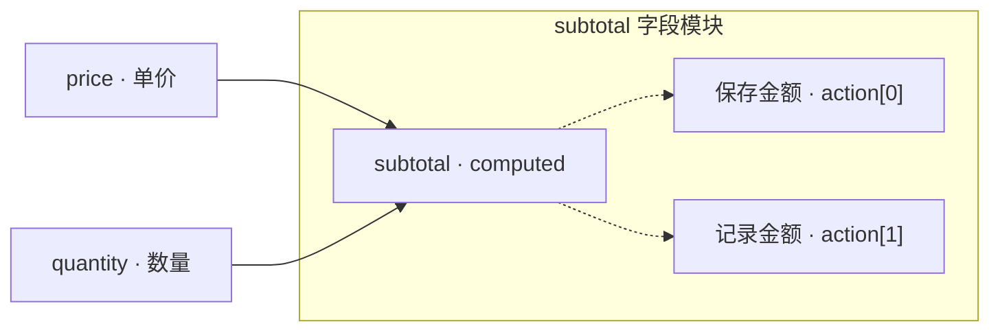

# 设计记录：收敛 Reaction，增强 action

> **状态：收敛方案、无参数 action、批次去重及逐项启动屏障已确认；尚未实现。**
> 更新日期：2026-11-11。
> Reaction 只保留 `fields`、`computed`、`action` 三个成员。
> 当前运行时只有单参数、单函数 action，并在每次计算提交成功后调用。
> 本文的无参数调用、函数数组及批次合并均用于指导后续实现。
> 原字段级 `reaction.effects` 提案暂不推进，原 D1–D8 不再作为实现清单。

## 1. 目标与取舍

本库主要服务字段模块，需要清楚展示字段计算关系和字段内的副作用。
此前独立 effects 引入了第二组依赖、初始化抑制、纯副作用分支和新的诊断渠道，
超出了当前需要。独立依赖系统暂不推进，但计算链中的重复 action 仍需要解决。

收敛为同一个 reaction 的三个职责：

- `fields`：什么字段变化会触发本次 reaction。
- `computed`：同步、纯粹地计算宿主字段值。
- `action`：本批次计算链落定且该 reaction 最终计算有效后，无参数调用一组
  请求、日志等副作用；业务通过闭包直接读取 model。

action 继续依附于计算流程，没有自己的依赖声明；内部将计算和 action 执行分为
两个阶段，保证同一计算批次内同一 reaction 的 action 最多执行一组。
虚线表示“计算链落定后的副作用执行关系”，不表示任意字段的独立订阅。
这是能力上的取舍，不能声称与原 effects 提案等价。

## 2. 最小类型扩展

```ts
type ReactionAction = () => void | PromiseLike<void>;

interface Reaction<T = any> {
  fields: string[];
  computed: (values: Record<string, any>) => T | typeof SKIP_REACTION;
  action?: ReactionAction | ReactionAction[];
}
```

保留当前公开 `Reaction<T>` interface 和同步 computed 契约，action
使用无参数函数或函数数组。`ReactionAction` 是否公开导出由实现决定。
不增加 `deps`、`run`、`writes` 等成员，也不把 computed 改成可选。

action 不接收依赖投影、computed 属性或 result 参数，也不为它增加泛型。
读取数据直接使用 `model.data.字段名` 或 `model.getField('字段名')`，
字段类型沿用 createModel 的模型数据推导；`Reaction<T>` 的 T 只约束 computed 返回值。

不再注入兼容用的 computed 属性，模型中名为 computed 的字段也不再被特殊参数覆盖。
先前的 `action(values, result)` 及保留旧第一参数的方案被本次无参数设计取代。

`interface X extends Reaction` 的使用方式可以保留；原本不使用参数的 action
回调也能沿用。依赖 `action(data)` 参数的旧声明需要改为通过闭包读取 model，
这是明确的破坏性参数变更。消费者直接调用 action 时仍需判断数组。
本方案还改变执行时机与次数，迁移说明应同时覆盖类型与运行时行为。

## 3. 字段模块示例

以下是待实现的 action 数组示例，`saveAmount` 与 `trackAmount` 由业务提供：

```ts
const model = createModel({
  price: { type: 'number', default: 10 },
  quantity: { type: 'number', default: 2 },
  subtotal: {
    type: 'number',
    default: 0,
    reaction: {
      fields: ['price', 'quantity'],
      computed: ({ price, quantity }) => price * quantity,
      action: [
        async () => {
          const { price, quantity, subtotal } = model.data;
          await saveAmount({ price, quantity, subtotal });
        },
        () => {
          trackAmount(model.data.subtotal);
        },
      ],
    },
  },
});
```

开发者仍只理解一组输入、字段计算，以及计算链落定后的操作。
多个副作用可以拆成独立函数，但不各自建立触发依赖。

读取 `model.data.subtotal` 明确表示模型中已提交的小计字段，
不再需要辨别某个 reaction 的原始 computed 返回值。
读取哪些字段不会自动生成订阅：需要因某字段变化而重跑该 reaction 时，
仍须将其列入 fields。图中的虚线表达已声明的触发关系，不是闭包的完整读写依赖。

## 4. 计算链落定后的批次合并

以下依据当前 [Reaction 类型](../src/types.ts)、
[processReaction](../src/reaction/reaction-system.ts) 和
[API 文档](API_CN.md)，说明为什么需要调整即时 action 的时序。

### 4.1 问题：一次级联更新可能发出多个中间请求

假设 `b` 依赖 `a`，`c` 依赖 `b`，total 的 reaction 声明
`fields: ['a', 'b', 'c']`。a 更新后，total 可能先后用以下输入重算：

| 次序 | 输入状态 | 现有异步校验场景中的 action |
|---|---|---|
| 1 | a 新值、b 旧值、c 旧值 | 可能发送中间状态。 |
| 2 | a 新值、b 新值、c 旧值 | 可能再次发送中间状态。 |
| 3 | a 新值、b 新值、c 新值 | 才是最终状态。 |

同步校验路径可能因过期校验结果被忽略而碰巧只执行一次 action，
但异步校验可以让三次提交分别成功，不能以请求 ID 机制代替 action 去重。
按时间防抖也不能保证计算链已经结束，因此本方案不增加 debounceActions 或固定延时。
既有 `debounceReactions` 的计算调度能力保持，批次协调需要等其待执行计算落定。

### 4.2 批次边界

一个计算批次覆盖尚未收尾的入口校验、批量提交、级联 computed 及其写回校验。
批量入口必须持有阶段任务，不能在某个字段先结束时误判整批计算完成。
重叠在同一计算阶段内的入口更新合并处理；计算阶段收尾时固定本批次待执行集合。

动作执行期间的回写或新的入口更新进入后续计算批次，不加入已经固定的 action
集合。新的独立变更仍可再次触发同一 reaction，去重不是模型整个生命周期只执行一次。
这不提供原子事务或每个并发 setField 都对应一次 action 的保证。

固定集合只确定这批候选的身份和版本，不表示之后可以无条件执行。
每项 action 启动前都必须检查当前计算状态与候选版本；
后续更新可以使旧候选失效，但不能将新候选追加到旧批次中。

### 4.3 去重与候选有效性

1. computed 继续响应依赖变化，遵循现有校验和提交管线。
2. 对包含 action 的 reaction 登记待执行项；记录最新计算版本及其提交是否有效，
   暂不调用 action，也不为 action 保存输入和计算结果参数。
3. 同一 reaction 再次调度时，更新其执行版本并使旧候选失效；
   最新计算成功后将候选标记为有效，不增加待执行项。
4. 本批次入口、计算及写回校验任务全部结束后，固定候选集合；
   对每项 action 通过启动屏障后再调用。

去重身份是“宿主字段 + reaction 身份”，可复用现有 ReactionJob。
不同字段复用同一个 reaction 对象仍是不同任务；同字段的不同 reaction 也不能合并。
不能按 action 函数引用去重，否则复用函数的字段模块会丢失执行。

有效候选必须对应该 reaction 的最新一次计算，而且提交结果仍有效。
最终一次计算若跳过、抛错、验证失败或因过期而未提交，不能执行遗留的中间候选。
一项计算失败不阻断其他 reaction 的有效候选。

执行版本按 ReactionJob 单调递增，覆盖同一批次和跨批次的重复调度，
不能在批次收尾时重置。候选保存登记时的版本，计算完成结果只有仍匹配最新版本
才能将其标记为有效，晚到的旧结果不能恢复已失效候选。
版本变化依据实际 reaction 调度；无关字段更新只影响计算屏障，
不自动使未被重新调度的 reaction 失效，也不从闭包读取推断新依赖。

有效候选在执行时无参数调用。action 通过 model 读取执行时的已提交状态，
不读取被调度器缓存的原始计算结果。候选记录的是是否允许执行，
不是一份历史数据快照；具体读取边界见 §5。

### 旧候选处理规则

新版本一经调度就使旧版本失效，不等新计算成功后才替换旧版本。
采用“最新版本决定是否执行”的规则：

| 旧版本所处阶段 | 新版本到来后的处理 |
|---|---|
| 候选组尚未启动，或正在等启动屏障 | 废弃旧组并结束其等待，不能再启动旧组任何一项。 |
| 组内某项已经开始执行 | 不强行取消该函数；标记旧组剩余未启动项为取消。 |
| 新版本计算有效 | 在新批次登记一组，从 action[0] 开始，不继承旧组执行下标。 |
| 新版本最终跳过、失败或提交过期 | 新组不执行，也不退回执行旧组。 |
| 新更新未重新调度此 reaction | 版本不变；未启动项等待当前计算落定后，仍可继续执行。 |

已经执行的副作用不能回滚。新组不需要等旧版本已开始项完成；
仍保留跨批次不新增串行队列的规则，已发请求的取消和过期回写由业务负责。
旧版本失效本身不是错误，不触发 reaction:error；已经开始的函数若拒绝，
仍观察其 Promise 并按原错误规则处理。

### 4.4 启动条件与生命周期

`processReaction` 需将“计算、校验和登记候选”与“调用 action”分开。
内部增加计算阶段完成判定和待执行 action 集合，但不增加独立 effects 依赖索引。
单纯扩展 action 数组遍历不足以解决重复触发。

**每项启动屏障**，包括组内第一项、每次 await 后的下一项，以及其他候选组的各项：

1. 检查模型未销毁、组未取消，且候选版本仍是本 reaction 的最新有效版本；
   已失效则直接结束剩余项。
2. 等待当前入口校验、批量提交、computed 及写回校验全部落定。
   此等待不包含 action 任务、已运行的 action Promise 或屏障自身。
3. 等待恢复后重新检查模型、版本及计算状态。版本失效则取消剩余项；
   期间若又开始了计算，重新等待，不能仅因上一轮空闲通知就启动。
4. 最终检查与函数调用必须在同一个同步执行段内完成，中间不插入 await
   或另一次调度。随后 await 该函数返回的 PromiseLike。
5. 函数完成后，对下一项从步骤 1 重新检查，不能只给整组检查一次。

等待计算期间，候选失效或 dispose 应唤醒等待项并取消，不能让已废弃的组继续
等待无关计算。取消整个未启动组可立即释放其任务；已经开始的函数仍需等待
返回的 Promise 结束，再完成该组的收尾。任务释放应幂等，避免重复取消时计数溢出。

所有等待与执行中的工作继续由 PendingTasks 追踪。
需要能单独判断入口校验和 computed 阶段是否落定，不直接等待包括 action 自身的
全局 `settled()`。这个阶段状态是内部协调信息，不引入第二个对外异步状态中心。
固定并登记 action 任务后再释放计算阶段持有任务，避免 settled 观察到假空闲。
重排新版本时同样先登记新计算任务，再释放已取消的旧候选或屏障等待任务。
同步抛错、异步拒绝、跳过、过期结果和销毁路径都要正确释放任务。

`dispose()` 清理未执行候选并停止启动新的 action，已启动的 Promise 仍须观察拒绝。
action 的异步结果不阻塞后续批次的字段计算；整体等待仍通过 settled。

无参数 action 会闭包引用由 createModel 返回的 model，初始化阶段也可能有合法
action，因此首次调用不得早于 createModel 返回。候选应在初始化计算阶段收尾后
调度，避免读取仍处于初始化表达式中的变量。

### 4.5 触发条件与兼容边界

| 情况 | 修正后的 action 行为 |
|---|---|
| `fields` 的依赖变化，同批次最终计算校验通过 | 计算链落定后执行一组，不随每次中间提交立即执行。 |
| 最终 computed 返回 `SKIP_REACTION`、抛错或返回 Promise | 不执行该 reaction 的 action，不能复用之前的候选。 |
| 最终计算值未通过校验，或提交结果因过期而被忽略 | 不执行该 reaction 的 action。 |
| 最终 computed 校验通过，但宿主值与原值相等 | 仍可执行一组；条件是最终计算有效，不新增值变化闸。 |
| 初始化计算有效 | 初始计算链落定后可以执行一组；不继承旧 effects 的“默认不执行”。 |
| 仅直接设置宿主字段 | 不因此单独执行该 reaction 的 action；仍由 fields 的触发路径决定。 |
| 新版本到来，旧组尚未启动或仍有剩余项 | 废弃未启动旧组或取消旧组剩余项；已开始的函数继续完成。 |

保留相等值和初始化的触发资格，但不保留旧 action 的参数，或每次成功计算后
立即调用的次数与时机。依赖旧参数、中间状态、每次计算日志或旧执行顺序的业务需要迁移。
延后 action 也会延后其错误上报，不能继续描述为运行时行为完全不变。
一个组执行到一半后可能因新版本而取消剩余项；不能承诺每个已开始组的全部
数组项最终都会执行。需要一次开始后连续完成的业务操作，应在一个 action 内组合。

## 5. action 执行与模型读取

数组表示一个有效候选对应的一组顺序操作：

1. 对仍有效的组按声明顺序无参数调用，每项分别通过启动屏障，
   每个函数返回的 PromiseLike 都 await。
2. 每个函数自行读取 model，不向整组函数注入共享参数或历史快照。
3. 某项同步抛错或异步拒绝，停止本次数组剩余项，沿用 `reaction:error` 上报。
4. 执行过程中销毁模型，不再启动剩余项。
5. 空数组是无操作；屏障等待、有效候选和函数返回的 PromiseLike 纳入 `settled()`。
   未 return 或 await 的脱离 Promise 不会被自动追踪。

顺序执行、遇错停止已确认，保留现有等待与错误处理契约，
与单个 async action 中连续 await 多个操作的行为一致。
需要并发或错误隔离时，业务可在一个 action 内使用 `Promise.all` 或显式 try/catch。

数组顺序仅针对当前一组，不新增同一字段或同一 action 跨批次的串行队列。
跨次请求可能重叠，不能因数组顺序而承诺旧请求不会影响新状态。

数组执行任务覆盖全部 await，并纳入 PendingTasks。
同一 action 函数在数组不同位置出现时，仍按声明次数执行；
批次去重减少的是同一 reaction 的重复启动，不合并数组项。
如果期间组版本失效，剩余位置取消；“按声明次数执行”只适用于未取消的组。

### 回写后再读取的执行示例

假设 b 依赖 a，组内第一项执行 `await model.setField('a', 2)`，
第二项要发送 a、b。setField 返回时 b 的异步计算可能尚未结束：

- 若该更新重新调度了本 reaction，旧组第二项取消；等待新计算有效后，
  新组从第一项开始，并对每项执行屏障检查。
- 若没有重新调度本 reaction，旧组第二项仍需等待 b 的计算及校验结束，
  重新确认版本有效后才能调用。

两种路径都不能在 b 的计算或校验尚未结束时启动第二项。
屏障等待任务落定，不代表全模型验证成功；如果 b 校验失败，其旧的已提交值仍会保留。

### 模型读取的时间边界

计算批次收尾时固定候选集合，各项启动前分别确认当前计算已落定且版本有效。
屏障保证的是函数进入时的状态，不是整个函数执行期间的事务锁：
已经开始的 action 内部 await 后仍可看到新批次的中间或最终状态，
调度器不会拦截函数内部的每次 model 读取。
不同数组项可以读到不同批次的已提交值，但不能在未落定的计算期间开始执行；
旧组是否还能启动下一项还受版本失效规则约束。

单次请求需要一致输入时，业务在函数开头读取一次 model.data，并从该快照提取字段：

```ts
const saveCurrentAmount = async () => {
  const data = model.data;
  await saveAmount({
    price: data.price,
    quantity: data.quantity,
    subtotal: data.subtotal,
  });
};
```

`model.data` 是稳定的浅冻结字段映射，后续字段替换不会改变已捕获快照的顶层值；
嵌套对象不深克隆或深冻结，业务仍不能原地修改字段内容。
如果多个操作必须共享同一输入，放进同一个无参数 action，
在开头捕获一次快照后执行这些操作即可。

多个 reaction 写入同一字段时，action 读取的是该字段执行时的已提交值，
包含 transform 后的结果及其他合法 reaction 的提交，未必等于自己那次 computed
的原始返回值。这个差异是采用 model 作为单一数据来源的设计取舍。

## 6. 字段图与副作用图



实线仍表示 `fields → 宿主字段` 的计算依赖；虚线从宿主字段节点指向所属 action，
表示计算链落定且该 reaction 最终计算有效后执行一组。
虚线不代表宿主值必须发生变化，也不代表所有直接 setField 都会执行 action。

action 节点属于字段模块，身份可由宿主字段、reaction 下标和 action 下标生成。
reaction 数组中的不同 action 保持各自身份，不按函数引用合并。
图表示 action 的归属与触发关系，数组中的执行顺序由 action 下标表达；
多条虚线不表示这些函数并行执行。
共同 schema 遍历为 DevTools 提供这些声明，图层不从函数内容推断读写依赖。
图协议可以扩展，但不需要新增运行时触发索引。

## 7. 业务组合与回写边界

请求只需监听普通字段、完全不需要派生值时，优先使用现有 `model.subscribe`
并提供独立 Recipe；不为 action 数组引入纯副作用 reaction 或伪 computed。
订阅回调启动的 Promise 不会自动纳入 reaction 的 `settled()`，
业务需自行负责等待、错误处理和取消订阅。

action 回写仍通过 `setField` / `setFields`。在 schema 回调中闭包引用正在推导的
model，表达式体可能形成 TS7022 / TS7023 推导循环；
直接返回写入的 `Promise<boolean>` 也不满足副作用的返回类型。
推荐 async 块体，await 写入但不返回布尔值：

```ts
action: async () => {
  const { subtotal } = model.data;
  await model.setField('requestResult', await request(subtotal));
}
```

回写形成循环、过期响应和取消请求仍由业务控制。
没有回写声明时，不能承诺构造时检测 action 的真实回写循环。
action 内也不能等待同一模型的 `settled()`，以免等待当前 action 自身。

## 8. 已确认方案与实现验收

| 项目 | 已确认规则 |
|---|---|
| 组合入口 | action 支持单函数或函数数组，Reaction 继续保留 interface。 |
| 参数 | action() 无参数，所有字段值通过闭包从 model 读取，不注入旧 computed 属性。 |
| 模型读取 | 读取执行时已提交状态；单次请求要稳定输入时，在 action 开头捕获 model.data。 |
| 批次去重 | 计算链落定后，同批次每个宿主字段下的同一 reaction 最多执行一组。 |
| 最终有效性 | 最终计算失败或跳过时不执行旧候选；候选仅保存版本与有效状态，版本跨批次递增。 |
| 逐项屏障 | 每项启动前等待当前计算落定并重新检查版本；检查与调用间不让出执行。 |
| 旧候选 | 新版本调度时废弃未启动旧组，取消执行中旧组剩余项；不取消已开始函数。 |
| 数组执行 | 有效组内按声明顺序 await，不按函数引用合并；新有效组从第一项重新执行。 |
| 单项失败 | 停止本次数组剩余项，复用 reaction:error；独立失败处理放在业务函数内。 |
| 触发与初始化 | 相等值和初始化仍有触发资格，但执行延后到计算链落定，不保留旧调用次数与时机。 |
| 等待 | 候选、屏障和返回的 PromiseLike 纳入 settled；启动屏障只等计算，不等 action 自身；脱离 Promise 不自动追踪。 |
| 依赖展示 | 实线表示字段计算依赖，虚线表示计算链落定后的 action 执行关系。 |

实现范围包括 action 类型、计算阶段协调、待执行候选去重、数组执行及 DevTools 展示。
不推进独立 effects、纯副作用 reaction 或按时间防抖；无需第二组依赖声明。

| 验收场景 | 应验证的行为 |
|---|---|
| 无参数签名与模型类型 | 无参数单函数及数组合法，model 字段类型可推导；要求旧参数的回调需要迁移。 |
| computed 类型 | Reaction 的 T 继续约束 computed，不完整计算和错误返回类型仍被拒绝。 |
| 多级链 a → b → c，reaction 依赖 a、b、c | 同步和异步校验下，同批次内按最新有效版本执行一组，函数进入时该链已经落定。 |
| 同一批次候选反复替换 | 只保留最新有效计算，最后跳过或失败时不执行之前的候选。 |
| 候选已封存但尚未启动时出现新版本 | 旧候选不能因集合已固定而继续执行；新版本失败也不回退旧候选。 |
| 组内第一项回写触发新版本 | 已开始项继续完成，旧组剩余项取消；新有效组从第一项开始。 |
| 更新只产生其他计算，未重排当前 reaction | 当前组版本仍有效，但下一项需等当前计算完成后才能启动。 |
| 空闲通知恢复前再次开始计算 | 恢复后复查计算状态，不能在新计算尚未落定时启动 action。 |
| 候选在屏障等待期间失效或 dispose | 等待被唤醒并取消，正确释放任务，不等待自己或继续启动剩余项。 |
| 执行时模型读取 | 读取已提交字段及 transform 后的值，不注入某个 reaction 的原始计算结果。 |
| await 前后及后续数组项 | 函数内部 await 后的读取不受屏障保护；下一项要重新检查；捕获快照顶层值保持稳定。 |
| 不同 reaction 及跨字段复用 | 候选身份按宿主与 reaction 区分，不能误合并。 |
| 后续独立变更与 action 回写 | 进入后续批次，仍能再次触发，不加入上一批固定候选集合。 |
| setFields 部分失败、异步校验与原有计算防抖 | 计算阶段正确收尾，合法 reaction 能执行，无假空闲或丢失候选。 |
| action 数组 | 按声明顺序执行，前一项的 PromiseLike 完成后才启动后一项。 |
| 同步抛错或异步拒绝 | 停止剩余项，沿用 reaction:error，正确释放任务。 |
| 空数组及重复函数引用 | 空数组无操作；未取消的组内，同一函数在不同位置按声明次数执行。 |
| 相等计算值及初始化 | 不增加值变化闸或初始化抑制；初次 action 启动晚于 createModel 返回，可安全闭包读取 model。 |
| 最终 SKIP_REACTION、计算错误及校验失败 | 不启动该 reaction 的任何 action 项，清理旧候选。 |
| 执行期间 dispose | 不再启动剩余项，已启动的 Promise 拒绝仍被观察。 |
| settled | 阶段交接不会提前返回，能等待候选和 action 数组处理，不发生等待自身。 |
| 未返回的业务 Promise | 不在 settled 保证范围内；业务必须 return/await 才能让整体等待覆盖请求。 |
| 类型与图协议 | 保留 Reaction interface 扩展能力；消费者判断数组并无参数调用；图展示共同声明。 |

公开类型和运行时变更落地时，再同步 README / README_CN、API / API_CN、
DEVTOOLS / DEVTOOLS_CN 及 AGENTS.md。本次只更新已确认的设计文档，不表示数组已受支持。

审核中另两项调度边界仍需后续确定：全模型持续有计算时，是否接受 action 一直
等待及是否限定批次范围；不同 reaction 组之间的启动顺序、并发和错误隔离规则。
本次只明确逐项启动屏障、旧候选处理，并修正 settled 的返回 Promise 追踪范围。
