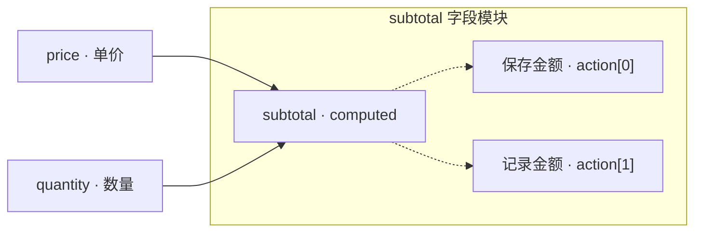

# 设计记录：收敛 Reaction，增强 action

> **状态：已实现无参数 action 数组、宿主 action 版本、统一任务统计及组间调度。**
> 更新日期：2026-11-12。
> Reaction 只保留 `fields`、`computed`、`action` 三个成员。
> 运行时支持无参数函数数组及计算落定后的候选合并，替换旧单参数、单函数 action。
> 公开执行契约与破坏性迁移见 [API_CN.md](API_CN.md#action-组)。
> 调度方向固定为：action 等待 reaction 计算落定；reaction 不等待 action。
> 原字段级 `reaction.effects` 提案暂不推进，原 D1–D8 不再作为实现清单。

## 1. 目标与取舍

本库主要服务字段模块，需要清楚展示字段计算关系和字段内的副作用。
此前独立 effects 引入了第二组依赖、初始化抑制、纯副作用分支和新的诊断渠道，
超出了当前需要。独立依赖系统暂不推进，但计算链中的重复 action 仍需要解决。

收敛为同一个 reaction 的三个职责：

- `fields`：什么字段变化会触发本次 reaction。
- `computed`：同步、纯粹地计算宿主字段值。
- `action`：本批次计算链落定且该 reaction 最终计算有效后，无参数调用一组
  请求、日志等副作用；业务通过闭包直接读取 model。

action 继续依附于计算流程，没有自己的依赖声明；内部将计算和 action 执行分为
两个阶段，保证同一计算批次内同一 reaction 的 action 最多执行一组。
虚线表示“计算链落定后的副作用执行关系”，不表示任意字段的独立订阅。
这是能力上的取舍，不能声称与原 effects 提案等价。

## 2. 最小类型扩展

```ts
type ReactionAction = () => void | PromiseLike<void>;

interface Reaction<T = any> {
  fields: string[];
  computed: (values: Record<string, any>) => T | typeof SKIP_REACTION;
  action?: ReactionAction[];
}
```

保留当前公开 `Reaction<T>` interface 和同步 computed 契约，action
使用无参数函数数组，不接受单函数形式。`ReactionAction` 已由包根公开导出。
不增加 `deps`、`run`、`writes` 等成员，也不把 computed 改成可选。

action 不接收依赖投影、computed 属性或 result 参数，也不为它增加泛型。
读取数据直接使用 `model.data.字段名` 或 `model.getField('字段名')`，
字段类型沿用 createModel 的模型数据推导；`Reaction<T>` 的 T 只约束 computed 返回值。

不再注入兼容用的 computed 属性，模型中名为 computed 的字段也不再被特殊参数覆盖。
先前的 `action(values, result)` 及保留旧第一参数的方案被本次无参数设计取代。

`interface X extends Reaction` 的使用方式可以保留；原本不使用参数的 action
函数体可以作为数组项沿用，但 schema 中必须改为数组形式。依赖 `action(data)` 参数的旧
声明需要改为通过闭包读取 model。本方案按破坏性更新推进，不提供旧签名或旧执行时序的
兼容层；消费者直接调用 action 时也需按数组处理。

## 3. 字段模块示例

以下是 action 数组示例，`saveAmount` 与 `trackAmount` 由业务提供：

```ts
const model = createModel({
  price: { type: 'number', default: 10 },
  quantity: { type: 'number', default: 2 },
  subtotal: {
    type: 'number',
    default: 0,
    reaction: {
      fields: ['price', 'quantity'],
      computed: ({ price, quantity }) => price * quantity,
      action: [
        async () => {
          const { price, quantity, subtotal } = model.data;
          await saveAmount({ price, quantity, subtotal });
        },
        () => {
          trackAmount(model.data.subtotal);
        },
      ],
    },
  },
});
```

开发者仍只理解一组输入、字段计算，以及计算链落定后的操作。
多个副作用可以拆成独立函数，但不各自建立触发依赖。

读取 `model.data.subtotal` 明确表示模型中已提交的小计字段，
不再需要辨别某个 reaction 的原始 computed 返回值。
读取哪些字段不会自动生成订阅：需要因某字段变化而重跑该 reaction 时，
仍须将其列入 fields。图中的虚线表达已声明的触发关系，不是闭包的完整读写依赖。

## 4. 计算链落定后的批次合并

以下记录从旧即时 action 迁移的原因；对应 [Reaction 类型](../src/types.ts)、
[processReaction](../src/reaction/reaction-system.ts) 和
[API 文档](API_CN.md)，说明为什么需要调整即时 action 的时序。

### 4.1 问题：一次级联更新可能发出多个中间请求

假设 `b` 依赖 `a`，`c` 依赖 `b`，total 的 reaction 声明
`fields: ['a', 'b', 'c']`。a 更新后，total 可能先后用以下输入重算：

| 次序 | 输入状态 | 旧即时 action 在异步校验场景中的行为 |
|---|---|---|
| 1 | a 新值、b 旧值、c 旧值 | 可能发送中间状态。 |
| 2 | a 新值、b 新值、c 旧值 | 可能再次发送中间状态。 |
| 3 | a 新值、b 新值、c 新值 | 才是最终状态。 |

同步校验路径可能因过期校验结果被忽略而碰巧只执行一次 action，
但异步校验可以让三次提交分别成功，不能以请求 ID 机制代替 action 去重。
按时间防抖也不能保证计算链已经结束，因此本方案不增加 debounceActions 或固定延时。
既有 `debounceReactions` 的计算调度能力保持，批次协调需要等其待执行计算落定。

### 4.2 批次边界

计算阶段包含入口校验、批量提交、已登记的 reaction debounce、computed 运行及
reaction 写回校验；不包含 action 的等待或返回的 Promise。action 等待计算落定，
计算不等待 action，因此 action 仍在运行时，新的字段更新及其 reaction 可以继续计算。

重叠在同一计算阶段内的入口更新合并处理。计算任务从有任务到归零时，取出当前
`pendingActions` 中的候选交给执行器，并换成空的候选表。此次交接就是一个批次；
无需额外的 Batch 对象、批次编号或历史批次存档。批量入口仍须持有整批计算任务，
不能在某个字段先结束时误判整批完成。

交接固定的是候选身份和版本，不是无条件执行许可；每项启动条件统一见 §4.4。
后续入口更新或 action 回写产生的新候选进入下一次交接，不追加到此前的集合。
新的独立变更仍可再次触发 action，这不提供原子事务或每次并发 setField 各执行一组的保证。

### 4.3 去重与候选有效性

计算任务继续按“宿主字段 + reaction 身份”区分，复用现有 ReactionJob。
不同字段复用同一个 reaction 对象仍是不同任务；同字段的不同 reaction 仍各自计算。
action 候选则按宿主字段保存，因为同一宿主仅允许最新调度者获得启动资格：

```ts
interface ActionCandidate {
  job: ReactionJob;
  version: number;
}

// 内部状态示意；候选关联的组任务由执行器管理。
const fieldActionVersion = new Map<string, number>();
const pendingActions = new Map<string, ActionCandidate>();
```

只维护宿主 action 版本，不再为 action 增加 ReactionJob 执行版本。
同宿主任何一次 reaction 调度都会推进该版本，已覆盖同 reaction 的重复调度和不同
reaction 的竞争。版本跨批次单调递增；候选保留具体 job，不按 action 函数引用合并。

1. 每次实际调度 reaction 时，推进宿主 action 版本，移除该宿主的待执行候选，
   并通知执行器取消旧组的未启动项；本次计算捕获推进后的版本。
   此规则也适用于未声明 action 或声明空数组的 reaction。
2. computed 继续走现有校验与提交管线。仅当提交成功、捕获的版本仍匹配当前宿主版本，
   且 action 数组非空时，登记候选并持有一项组任务。
3. 跳过、抛错、返回 Promise、校验失败或过期未提交时，不登记候选。
   候选表只保存成功且版本匹配的项，无需额外 `valid` 标记；晚到的旧计算不能恢复旧候选。
4. 成功的直接字段值变更也推进该字段的 action 版本并使旧组失效，但不登记候选；
   包括 setField、setFields 和 validateAll 提升 dirty 值的直接提交。reaction 自身写回
   不再次推进版本。直接提交应在通知订阅者及触发下游前更新 action 资格。
   无关字段更新只影响计算屏障，不使当前宿主版本变化，也不从闭包读取推断依赖。

**调度版本的传递约定。** 版本在 `scheduleReaction` 调度时推进并捕获，随后沿
`scheduleReaction → runReaction → processReaction → ActionCandidate.version` 传递。
防抖路径在 `ScheduledReaction` 中增加 `actionVersion`，保存该次调度捕获的值；
无防抖路径传递同一个值。计算运行、校验完成及候选登记时都不能读取当前宿主版本
作为自己的版本，只能用捕获值与当前值比较。

同 job 的防抖重排用新调度记录替换旧记录，并捕获新版本；同宿主其他 job 的待执行
记录仍保留各自捕获的版本。例如 A 捕获 v1，B 随后捕获 v2：即使防抖后 A 才运行，
也仍以 v1 检查；B 跳过时，A 不能冒用 v2 恢复候选。传递的是同一宿主版本的快照，
不新增 ReactionJob 版本计数器。

**提交来源的传递约定。** 给内部 [CommitOptions](../src/types.ts) 增加
`origin: 'direct' | 'reaction'`，各内部提交入口显式设置，并沿
`updateField / validateAndCommit → commitValid` 保留：

- setField、setFields、validateAll 的直接提交使用 `origin: 'direct'`；
  action 内调用这些公开 API 也属于直接提交。
- `processReaction` 经 setValue 回调写回 computed 结果时使用 `origin: 'reaction'`，
  包括初始化计算；该提交触发的下游 computed 写回也各自标记为 reaction。
- `commitValid` 仅在 `origin === 'direct'` 且字段值真实变化时推进 action 版本。
  不根据 reactionStack 是否为空、changedFields 是否存在或调用栈猜测来源。

origin 只供库内部使用，不增加公开写入参数或 schema 成员，也不改变校验和提交规则。

**action 资格与字段提交分开。** 现有 `validationRequestIds` 仍控制校验结果、值提交和
过期结果处理；`fieldActionVersion` 只决定 action 能否启动，不替代校验请求 ID，
也不因 action 版本变化而额外阻止某次计算值提交。

沿用的 [processReaction](../src/reaction/reaction-system.ts) 在 `SKIP_REACTION` 或计算
抛错时不发起新的字段校验，前一个有效写入仍可能提交；
[测试](../src/__tests__/reaction-system.test.ts)保留最后一个 reaction 跳过时
前一个写入仍生效的校验；旧版该场景的 action 也会执行。本方案保留计算提交规则，但新增“最新调度即淘汰旧
action 资格”：即使较早计算值仍能提交，只要最新 reaction 跳过或失败，该宿主本轮也
不启动 action。这个变化不是对现有运行时行为的沿用，迁移边界见 §4.5。

旧组处理统一由宿主 action 版本决定：

| 情况 | 处理 |
|---|---|
| 版本变化，旧组尚未启动或正在等屏障 | 唤醒并取消旧组，释放其组任务。 |
| 版本变化，旧组某项正在执行 | 继续观察已开始函数的 Promise，取消剩余项；函数结束后释放组任务。 |
| 最新 reaction 成功提交且版本匹配 | 登记新组，从 action[0] 开始，不继承旧组下标。 |
| 最新 reaction 跳过、失败或提交过期 | 不登记新组，不回退旧组；其他宿主的有效组不受影响。 |
| 仅无关字段开始新计算 | 版本不变，未启动项等待计算落定后仍可继续。 |

已执行的副作用不能回滚，新组不等待旧组已开始项完成。版本失效不是错误，
不触发 reaction:error；已开始函数若拒绝，仍按原错误规则处理。
已发请求的取消和过期回写由业务负责。晚到错误对字段错误状态的影响见 §4.5。

### 4.4 统一任务统计与逐项启动

扩展现有 [PendingTasks](../src/core/pending-tasks.ts)，在其中统一管理计算与 action 两类任务，
内部可使用 `begin('compute')` 和 `begin('action')`，原无参数 begin 默认归入计算任务。
分类计数及生命周期仍归同一个 PendingTasks 所有：

- 计算任务归零：交接候选，允许执行器尝试启动 action。
- 两类任务都归零：完成 `settled()`；action 自身及其屏障不计入计算任务。
- begin 返回的释放函数继续幂等；dispose 统一清理统计并唤醒等待者。

保留 ModelManager 的整批持有任务、字段校验任务，以及 ReactionSystem 覆盖 debounce、
computed 和写回校验的计算任务。`processReaction` 登记候选后结束计算任务，
不继续等待 action Promise。计算空闲不通过总任务数或全局 `settled()` 判定，
也不由另一个独立计数器维护。

**每组只持有一项 action 任务**，从有效候选登记开始，覆盖交接、各次屏障等待、
数组项的 Promise，直到整组完成、失败或取消。候选、屏障和执行是同一组的生命周期，
不分别登记任务；空数组不创建候选或组任务。

逐项启动逻辑集中在一个 action 执行器中；包括首项和每次 await 后的下一项：

1. 检查模型未销毁且组版本匹配当前宿主 action 版本；失效则结束剩余项。
2. 等待 §4.2 定义的计算阶段落定，期间版本变化或 dispose 应唤醒并取消等待，
   不能继续等待无关计算。
3. 恢复后重新检查模型、宿主版本和计算状态；若又开始计算则重新等待。
4. 最终检查与无参数调用必须在同一个同步执行段内完成，中间不插入 await
   或另一次调度。随后 await 函数返回的 PromiseLike。
5. 本项完成后，下一项重新执行上述检查；本项抛错或拒绝则停止该组并沿用 reaction:error。

有效候选的组任务必须在所属计算任务释放前登记；新计算任务也须在取消旧组前登记。
交接及替换均不能让 `settled()` 观察到假空闲。候选失效及组执行的所有退出路径均须
正确释放相关任务；跳过或计算失败不创建新组任务。已开始函数的 Promise 在普通版本取消后仍须等到结束。
dispose 保留当前立即释放 settled 等待者的语义，已开始 Promise 的拒绝继续被观察，
不要求销毁后的 settled 等待其完成。

首次 action 调用不得早于 createModel 返回，以保证闭包可以读取初始化表达式中的 model。
若模型持续有计算任务，action 会继续等计算空闲，不承诺有界启动延迟。

### 4.5 触发条件与兼容边界

| 情况 | 修正后的 action 行为 |
|---|---|
| 依赖变化后，宿主最新调度的 reaction 成功提交且版本匹配 | 计算链落定后执行一组。 |
| 最新计算跳过、抛错、返回 Promise、校验失败或提交过期 | 不登记候选，不复用旧候选，具体规则见 §4.3。 |
| 最新 computed 校验通过，但宿主值与原值相等 | 仍可登记候选，不增加值变化闸。 |
| 初始化计算有效 | 初始计算链落定后可执行一组，不增加初始化抑制。 |
| 仅直接设置宿主字段 | 不单独触发 action；真实值变更使旧候选失效。 |

保留相等值和初始化的触发资格，但不保留旧 action 的参数，或每次成功计算后
立即调用的次数与时机。依赖旧参数、中间状态、每次计算日志或旧执行顺序的业务需要迁移。
延后 action 也会延后其错误上报，不能继续描述为运行时行为完全不变。

同宿主最新 reaction 跳过或计算抛错时淘汰旧 action，是新增的破坏性行为；
现有 API 中 `SKIP_REACTION` 不取代前一个写入的规则仍保留。
旧业务若依赖“后一个跳过，前一个仍发请求”，需迁移到一个明确处理该分支的 reaction。
一个已开始组也可能因版本变化取消剩余项；需要开始后连续完成的业务操作，
应在一个 action 数组项内组合。

**晚到错误沿用现有字段错误契约。** 模型未销毁时，已开始的旧 action 即使版本失效，
其同步错误或 Promise 拒绝仍走现有 `handleReactionError` 管线：先向宿主字段的
`validationErrors` 追加 `reaction_error`，再发出 `reaction:error`。
错误上报不以宿主 action 版本过滤，也不由调度器取消其他有效组。

因此，新版本已成功提交、字段值为 4 且错误为空后，旧 action 晚到拒绝仍可能让该
字段新增旧操作的错误，字段值仍为 4。组间错误隔离仅隔离执行任务，不为同宿主字段
的错误状态提供版本隔离；业务不能将“当前字段有 reaction_error”直接解释为最新
计算或最新 action 失败。晚到错误是否改为仅发事件而不写字段状态，属于独立错误契约
调整，不包含在本次方案中。

dispose 后继续观察已开始 Promise 的拒绝以避免未处理拒绝，但沿用现有销毁检查，
不再写入字段错误或发出 reaction:error，也不恢复已清理的状态；任务等待边界见 §4.4。

## 5. action 执行与模型读取

数组表示一个有效候选对应的一组顺序操作，每项都是独立的启动边界，执行规则见 §4.4。
等待返回的 Promise、遇错停止与单个 async 函数中连续 await 相同；
数组额外具有逐项计算屏障和版本失效后的剩余项取消，不能声称二者完整行为等价。

同一函数出现在数组不同位置时，未取消的组仍按声明次数执行；去重不合并数组项。
需要组内并发或错误隔离时，业务可在一个数组项内使用 `Promise.all` 或显式 try/catch。
只有返回或内部 await 的 Promise 才被该组任务覆盖，脱离的 Promise 不会自动纳入 settled。

### 组间启动、并发与错误隔离

1. 执行器同一轮内同时就绪的组，按 schema 字段声明顺序尝试启动首项或下一项。
   就绪要求该组上一项已完成，并通过 §4.4 的启动检查；不同时间就绪的项不承诺全局顺序。
2. 每次调用前重新检查计算状态。某项同步回写并开始新计算时，尚未启动的其他项暂停，
   等计算落定后再检查版本并尝试启动。
3. 各组独立 await 自己的 Promise，不等待其他组的 Promise；某组抛错或拒绝只停止该组，
   不取消其他组。组内按数组顺序执行，组间可以并发；字段错误状态的兼容行为见 §4.5。

不增加同一字段或同一函数跨批次的串行队列，新有效组可以与旧组已开始的函数重叠。
因此数组顺序不提供请求取消或过期响应保护，仍需业务控制回写。

### 回写后再读取的执行示例

假设 b 依赖 a，组内第一项执行 `await model.setField('a', 2)`，
第二项要发送 a、b。setField 返回时 b 的异步计算可能尚未结束：

- 若该更新重新调度了本 reaction，旧组第二项取消；等待新计算有效后，
  新组从第一项开始，并对每项执行屏障检查。
- 若没有重新调度本 reaction，旧组第二项仍需等待 b 的计算及校验结束，
  重新确认版本有效后才能调用。

两种路径都不能在 b 的计算或校验尚未结束时启动第二项。
reaction 计算不等待第一项 action 完成；启动屏障只约束 action 组下一项何时开始。
屏障等待任务落定，不代表全模型验证成功；如果 b 校验失败，其旧的已提交值仍会保留。

### 模型读取的时间边界

计算批次收尾时固定候选集合，各项启动前分别确认当前计算已落定且版本有效。
屏障保证的是函数进入时的状态，不是整个函数执行期间的事务锁：
已经开始的 action 内部 await 后仍可看到新批次的中间或最终状态，
调度器不会拦截函数内部的每次 model 读取。
不同数组项可以读到不同批次的已提交值，但不能在未落定的计算期间开始执行；
旧组是否还能启动下一项还受版本失效规则约束。

单次请求需要一致输入时，业务在函数开头读取一次 model.data，并从该快照提取字段：

```ts
const saveCurrentAmount = async () => {
  const data = model.data;
  await saveAmount({
    price: data.price,
    quantity: data.quantity,
    subtotal: data.subtotal,
  });
};
```

`model.data` 是稳定的浅冻结字段映射，后续字段替换不会改变已捕获快照的顶层值；
嵌套对象不深克隆或深冻结，业务仍不能原地修改字段内容。
如果多个操作必须共享同一输入，把它们组合在同一个数组项的无参数函数里，
在函数开头捕获一次快照后执行这些操作即可。

action 读取的字段值包含 transform 后的提交结果，不读取某次 computed 的原始返回值。
宿主 action 版本只控制启动资格，不保存历史输入或结果快照。

## 6. 字段图与副作用图



实线仍表示 `fields → 宿主字段` 的计算依赖；虚线从宿主字段节点指向所属 action，
表示计算链落定且该 reaction 最终计算有效后执行一组。
虚线不代表宿主值必须发生变化，也不代表所有直接 setField 都会执行 action。

action 节点属于字段模块，身份可由宿主字段、reaction 下标和 action 下标生成。
reaction 数组中的不同 action 保持各自身份，不按函数引用合并。
图表示 action 的归属与触发关系，数组中的执行顺序由 action 下标表达；
多条虚线不表示这些函数并行执行。
共同 schema 遍历为 DevTools 提供这些声明，图层不从函数内容推断读写依赖。

DevTools 仅扩展字段声明元数据，按 reaction 下标和 action 下标列出数组项。
现有字段计算图继续负责字段布局，图层在对应字段模块内部绘制 action 节点及虚线；
action 不作为计算图中的调度节点，也不需要新增运行时触发索引。
声明元数据不携带候选、版本、屏障或执行状态。

## 7. 业务组合与回写边界

请求只需监听普通字段、完全不需要派生值时，优先使用现有 `model.subscribe`
并提供独立 Recipe；不为 action 数组引入纯副作用 reaction 或伪 computed。
订阅回调启动的 Promise 不会自动纳入 reaction 的 `settled()`，
业务需自行负责等待、错误处理和取消订阅。

action 回写仍通过 `setField` / `setFields`。在 schema 回调中闭包引用正在推导的
model，表达式体可能形成 TS7022 / TS7023 推导循环；
直接返回写入的 `Promise<boolean>` 也不满足副作用的返回类型。
推荐 async 块体，await 写入但不返回布尔值：

```ts
action: [async () => {
  const { subtotal } = model.data;
  await model.setField('requestResult', await request(subtotal));
}]
```

回写形成循环、过期响应和取消请求仍由业务控制。
没有回写声明时，不能承诺构造时检测 action 的真实回写循环。
action 内也不能等待同一模型的 `settled()`，以免等待当前 action 自身。
`await model.setField()` 等待该字段的校验与提交，不保证它触发的下游 reaction 已落定；
若 action 函数在这次 await 后立即读取派生字段，当前 API 没有单独的 reaction-idle 等待方法。
action 数组的逐项启动屏障可以保证下一项等到计算阶段落定，但 action 函数内部的普通
`await` 不会自动插入该屏障。

## 8. 已确认方案与实现验收

公开签名以 §2 为准，候选与任务规则以 §4 为准，组间执行及读取边界以 §5 为准，
图展示以 §6 为准。实现按职责分工，不另建一套重复的调度状态：

| 实现位置 | 职责 |
|---|---|
| 公开类型 | 无参数 action 数组，保留 Reaction interface 与同步 computed 契约。 |
| PendingTasks | 统一管理任务分类、计算空闲、整体 settled、幂等释放及销毁唤醒。 |
| ModelManager | 保留入口与批量计算任务、校验请求 ID；沿提交管线保留 origin，仅直接值变更通知 action 资格失效。 |
| ReactionSystem | 保留独立计算任务；调度时捕获宿主 action 版本，经防抖及计算管线传递，提交后登记候选并结束计算阶段。 |
| action 执行器 | 独立模块管理每组的一项任务、逐项启动、取消、错误及组间调度；已开始函数的晚到错误沿用现有管线。 |
| DevTools | 提供 action 声明元数据，在字段模块内部展示副作用节点。 |

不推进独立 effects、纯副作用 reaction 或按时间防抖；无需第二组依赖声明、action 的
ReactionJob 执行版本、候选有效性标记或 Batch 存档。

| 验收场景 | 应验证的行为 |
|---|---|
| 无参数签名与模型类型 | action 函数数组合法、单函数形式不接受，model 字段类型可推导；旧参数回调需要迁移。 |
| computed 类型 | Reaction 的 T 继续约束 computed，不完整计算和错误返回类型仍被拒绝。 |
| 多级链 a → b → c，reaction 依赖 a、b、c | 同步和异步校验下，同批次内按最新有效版本执行一组，函数进入时该链已经落定。 |
| 同一批次候选反复替换 | 只保留最新有效计算，最后跳过或失败时不执行之前的候选。 |
| 候选已封存但尚未启动时出现新版本 | 旧候选不能因集合已固定而继续执行；新版本失败也不回退旧候选。 |
| 多个 reaction 竞争同一宿主字段 | 只有该宿主字段最新调度且最终有效的 reaction 可启动 action 数组；最新者失败时不回退。 |
| 最后一个 reaction 跳过或计算抛错，较早写入仍有效 | 保留现有计算提交规则，较早值仍可提交，但旧 action 资格已失效；不得混用两类版本。 |
| 旧计算结果晚到 | 捕获的宿主 action 版本不匹配时不能恢复候选；值提交仍由现有校验请求 ID 决定。 |
| 防抖中同宿主 A(v1)、B(v2)，B 最终跳过 | A 从调度到计算完成始终携带 v1，不能读取 v2 冒用资格；本轮不启动该宿主 action。 |
| 同 job 防抖重排及无防抖执行 | 重排记录捕获新调度版本；两条路径均将捕获值传递到候选登记，不在运行时重新取当前版本。 |
| 最新 reaction 未声明 action 或使用空数组 | 仍淘汰同宿主旧组，但不登记新候选或组任务。 |
| action 启动前直接修改宿主字段 | 成功的值变更使旧候选失效，但直接写入不自行触发 action。 |
| 直接提交与 reaction 写回的来源 | setField、setFields、validateAll 标记 direct；computed 写回标记 reaction，后者不因自身提交再次推进 action 版本。 |
| action 内公开回写及下游派生提交 | 公开回写仍为 direct，其触发的下游 computed 写回为 reaction；来源沿提交管线保留，不借助 reactionStack 或 changedFields 判断。 |
| 组内第一项回写触发新版本 | 已开始项继续完成，旧组剩余项取消；新有效组从第一项开始。 |
| 更新只产生其他计算，未重排当前 reaction | 当前组版本仍有效，但下一项需等当前计算完成后才能启动。 |
| 空闲通知恢复前再次开始计算 | 恢复后复查计算状态，不能在新计算尚未落定时启动 action。 |
| 候选在屏障等待期间失效或 dispose | 等待被唤醒并取消，正确释放任务，不等待自己或继续启动剩余项。 |
| 执行时模型读取 | 读取已提交字段及 transform 后的值，不注入某个 reaction 的原始计算结果。 |
| await 前后及后续数组项 | 函数内部 await 后的读取不受屏障保护；下一项要重新检查；捕获快照顶层值保持稳定。 |
| 不同 reaction 及跨字段复用 | 计算任务按宿主与 reaction 区分；候选按宿主保存并保留具体 job，跨字段不能误合并。 |
| 后续独立变更与 action 回写 | 进入后续批次，仍能再次触发，不加入上一批固定候选集合。 |
| action 仍在等待时发生回写 | 回写触发的 reaction 可在 action Promise 完成前运行；该计算阶段生成的 action 候选仍等计算落定后启动。 |
| setFields 部分失败、异步校验与原有计算防抖 | 计算阶段正确收尾，合法 reaction 能执行，无假空闲或丢失候选。 |
| action 数组 | 按声明顺序执行，前一项的 PromiseLike 完成后才启动后一项。 |
| 多组同时就绪 | 按 schema 字段声明顺序尝试启动；前一组挂起 Promise 不阻止其他有效组启动。 |
| 组间同步回写 | 前一项开始新计算后，其他未启动项等待计算落定并复查版本。 |
| 组间错误隔离 | 一组同步抛错或异步拒绝仅停止该组，其他有效组继续；错误仍按宿主字段存储。 |
| 新版本成功提交后旧 action 拒绝 | 保留新字段值，向该宿主 validationErrors 追加旧 reaction_error 并发出事件；不由调度器取消新组，整体 settled 覆盖旧 Promise 收尾。 |
| 同步抛错或异步拒绝 | 停止剩余项，沿用 reaction:error，正确释放任务。 |
| 空数组及重复函数引用 | 空数组无操作；未取消的组内，同一函数在不同位置按声明次数执行。 |
| 相等计算值及初始化 | 不增加值变化闸或初始化抑制；初次 action 启动晚于 createModel 返回，可安全闭包读取 model。 |
| 最终 SKIP_REACTION、计算错误及校验失败 | 不启动该 reaction 的任何 action 项，清理旧候选。 |
| 执行期间 dispose | 不再启动剩余项，唤醒 settled 等待者；已启动的 Promise 拒绝仍被观察。 |
| dispose 后旧 action 拒绝 | 拒绝被观察，但不写入字段错误、不发出 reaction:error，也不恢复已销毁的模型状态。 |
| settled | 阶段交接不会提前返回，能等待候选和 action 数组处理，不发生等待自身。 |
| 同一组反复等待及取消 | 同一组任务覆盖候选、交接、屏障和执行；取消及完成幂等释放，无提前 settled 或残留等待。 |
| action/reaction 分阶段 | 挂起 action Promise 后更新字段，验证 reaction 能完成；`settled()` 仍等待挂起的 action。 |
| 未返回的业务 Promise | 不在 settled 保证范围内；业务必须 return/await 才能让整体等待覆盖请求。 |
| 类型与图协议 | 保留 Reaction interface 扩展能力；消费者按数组无参数调用；action 只扩展声明元数据与字段内部展示。 |

README / README_CN、API / API_CN、DEVTOOLS / DEVTOOLS_CN、ADVANCED / ADVANCED_CN
及 AGENTS.md 已同步数组签名、调度契约和迁移边界。验收测试主要位于
[action-executor.test.ts](../src/__tests__/action-executor.test.ts)，任务分类、类型及
DevTools 声明分别由对应测试覆盖。

action 函数内部写回后若必须立即读取下游派生值，仍需业务侧编排；是否增加独立的
计算空闲等待 API 不属于本次实现范围。逐项屏障只保护每个数组项的启动时刻，
持续计算导致 action 延后启动是“action 等计算”取舍的直接结果。
